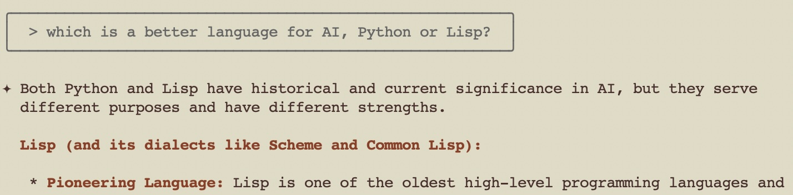
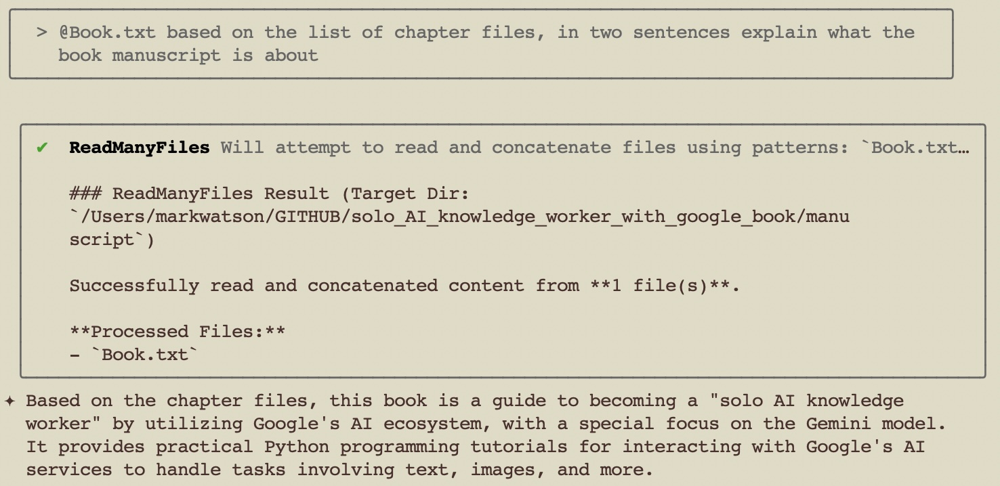
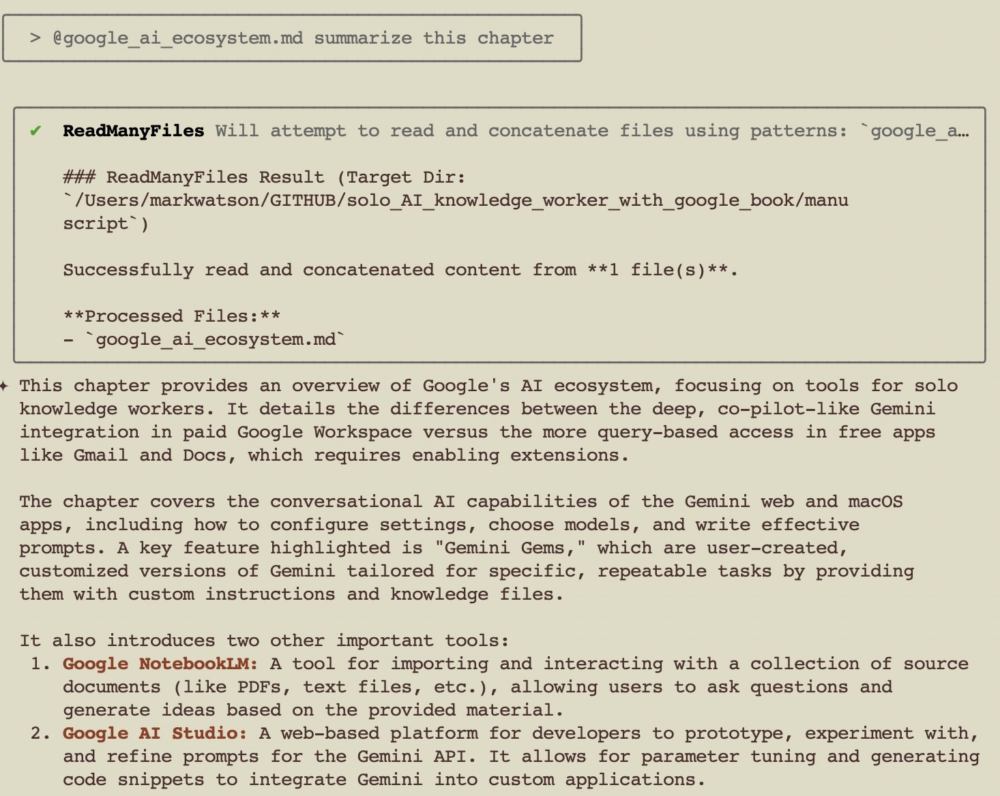
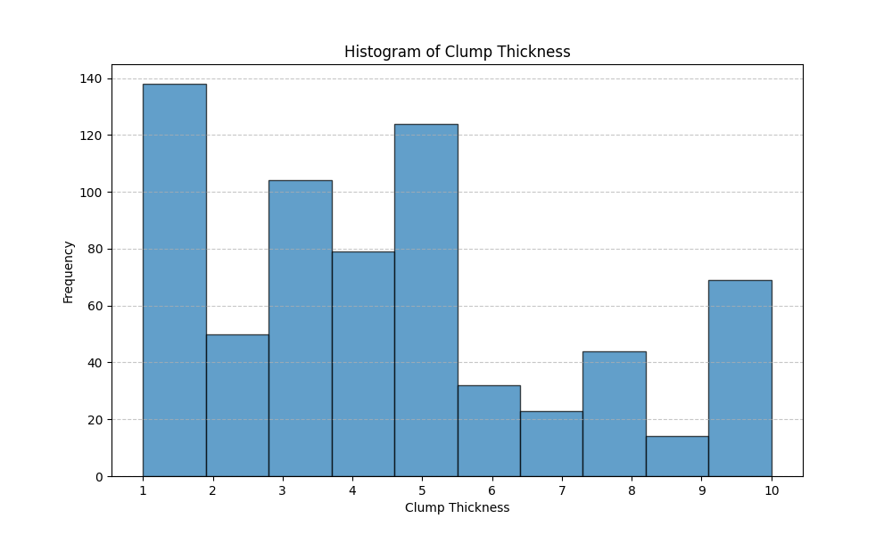
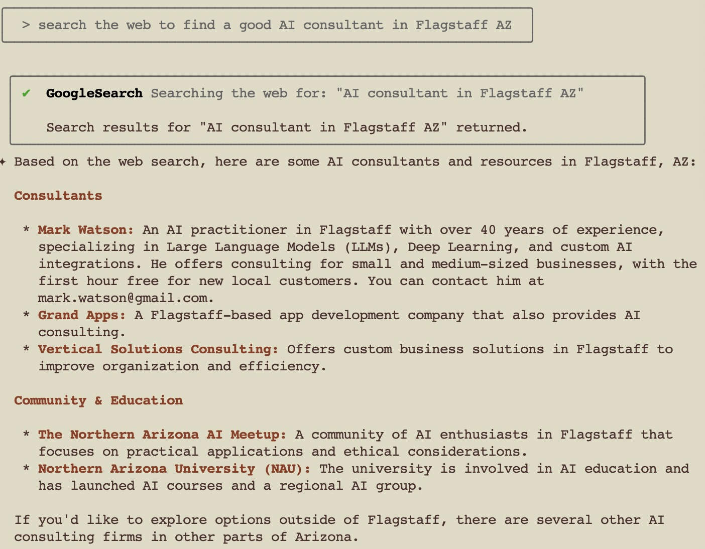

# Introducing the Antigravity CLI (agy): Your AI Agent in the Terminal

The Antigravity CLI puts a full AI agent in your terminal. For solo knowledge workers it turns the shell into a place to automate tasks and work with your own digital assets, without leaving the command line and without writing any code.

**Note:** Some of the examples in this chapter are screenshots (light brown background) and others are output text copied into this manuscript file.

## What the Antigravity CLI Is and Why It Matters for Solo Workers

The Antigravity CLI is the terminal surface of Google Antigravity, the agent harness that also powers the Antigravity desktop app and IDE. The binary is called **agy**. It runs an agent that reads and writes local files, runs shell commands, searches the web, and keeps one continuous context across many steps. That last property is what separates it from a chat window. You can point it at a folder of documents and ask for a finished deliverable.

Why this matters for the solo practitioner:

- **No server, no setup project.** One binary installs with one command and needs no Node.js, no npm, and no Python.
- **Runs on the plan you already have.** It signs in with your Google account. On the free and Google AI Plus tiers you still get Gemini Flash models.
- **Model choice in one harness.** You can switch among Gemini, Claude, and GPT-OSS models with the `/model` command. That is useful when one model is better at drafting and another is better at checking work.
- **It works with any folder.** The agent does not care whether the folder holds software, a manuscript, or a set of spreadsheets.
- **Headless mode.** `agy -p "prompt"` runs one prompt and exits. That makes the tool scriptable for batch work.

## Getting Started: Installation and Authentication

### Install the binary

On macOS, Linux, and Googlebook, run the installer script. It downloads the binary to `~/.local/bin/agy`:

```console
curl -fsSL https://antigravity.google/cli/install.sh | bash
```

On Windows, use PowerShell or CMD. The installer writes the binary to `C:\Users\<username>\AppData\Local\agy\bin`:

```powershell
irm https://antigravity.google/cli/install.ps1 | iex
```

```cmd
curl -fsSL https://antigravity.google/cli/install.cmd -o install.cmd && install.cmd && del install.cmd
```

Check the installation and see the version:

```console
agy --version
```

Run `agy update` later to update an existing installation.

### Authenticate with your Google account

Start the tool:

```console
agy
```

The first run asks you to sign in. `agy` looks for a saved session in your operating system keyring (Apple Keychain, Linux Secret Service, or Windows Credential Manager). If it finds one, it signs you in silently. If not, it opens your default browser and you sign in with your personal Google account. Use **Business account** instead when your organization gives you Gemini Enterprise access.

Over SSH there is no local browser, so `agy` prints an authorization URL. Open that URL on any machine where you are signed in, approve the request, and paste the authorization code back into the terminal. The CLI then caches the credential in the keyring, so you do this once.

To disconnect and purge the saved token from the keyring:

```console
/logout
```

### Using a Gemini API key instead

You do not need an account session if you have a Gemini API key. This suits headless and CI runs, where no browser exists to complete a sign-in. Create a key in [Google AI Studio](https://aistudio.google.com/app/api-keys), then:

1. Set `modelProvider` to `gemini` in `~/.gemini/antigravity-cli/settings.json`:

    ```json
    {
        "modelProvider": "gemini"
    }
    ```

2. Export the key. The CLI reads only `GEMINI_API_KEY`, and it does not read `.env` files:

    ```console
    export GEMINI_API_KEY="your-api-key"
    ```

Start `agy` again. It skips the sign-in screen and the header shows **Gemini API key** instead of your email address. Set a key in `GOOGLE_API_KEY` and nothing happens, which is the mistake readers hit first.

### Choose a model

Type `/model` in the prompt box to open the model picker. The choice persists across sessions. The Gemini models carry a reasoning effort setting, from low through high, so you can trade latency for depth per task.

Model availability depends on your plan, and it changes monthly. The picker is the source of truth. As I write this in October 2026, Antigravity serves the Gemini Flash and Pro models on every tier, and it also offers Claude Sonnet and Opus and GPT-OSS 120B, with those non-Google models limited to the paid tiers. Google has announced that the Claude and GPT-OSS options listed today will be removed on November 2, 2026. Treat that as the normal state of affairs rather than an exception: check the picker, and expect a different list next year.

## Core Concepts and Commands

The interactive prompt is your main channel to the agent. You type natural language, and the agent decides which tools to call.

Some inputs are commands rather than conversation. A leading forward slash marks a command, and a leading at sign pulls a file or folder into the context:

| Input | Meaning |
| --- | --- |
| `/model` | Choose the reasoning model |
| `/permissions` | Open the tool permissions manager |
| `/agents` | Open the Agent Manager and watch background subagents |
| `/resume` | Pick up an earlier conversation |
| `/diff` | Review changes the agent made |
| `/usage` | Show model quota usage |
| `/config` | Open the settings editor |
| `/help` | List commands and keybindings |
| `@path/to/file` | Add a file to the working context |

A leading exclamation mark runs a shell command and puts the output in the conversation, for example `!ls -la`.

The agent shows you what it is about to do. Press `y` to approve a tool call and `n` to reject it. The `Ctrl+K` shortcut approves the pending action without leaving the prompt. If you tire of approving every write, open `/permissions` and raise the approval level, but understand the tradeoff: `always-proceed` lets the agent write files and run commands with no confirmation. The settings file `~/.gemini/antigravity-cli/settings.json` exposes the same choice through `toolPermission`, and `enableTerminalSandbox` confines the commands the agent runs.

Run the tool inside a folder you are willing to let the agent modify. That one habit prevents almost every unpleasant surprise.

## Practical Use Cases for the Solo Knowledge Worker

We look at three examples in this section:

- Asking general questions
- Reading your own files into context
- Analyzing a CSV data file

### Asking general questions

You can use the prompt box for ordinary questions. Here I ask a technical question with no files in context:



### Working with files in the current directory

Put an `@` in front of a file name to read that file into the working context. In a directory full of source code I often add several files at once. The same idea works for a folder of research PDFs or a set of chapter drafts.

The important thing to remember is that the agent works on whatever directory you started it in, so start it where your material lives.



### Summarize a chapter

Working in the directory for this book manuscript, I asked for a summary of a chapter I wrote months earlier. The agent read the file, then produced a summary that matched my own description of the chapter. This is the cheapest useful thing you can do with an agent CLI: turn a file you wrote into something you can skim.



### Analyze a CSV file

I created an empty directory, copied a University of Wisconsin cancer data file named `labeled_cancer_data.csv` into it, and started the agent. Then I asked it to look at the file and describe the columns:

```console
> @labeled_cancer_data.csv look at this file and describe the data columns

ReadFile  Reading labeled_cancer_data.csv

This file contains data related to breast cancer diagnosis. Each row represents a
sample with the following attributes:

  * Cl.thickness: Clump Thickness (1-10)
  * Cell.size: Uniformity of Cell Size (1-10)
  * Cell.shape: Uniformity of Cell Shape (1-10)
  * Marg.adhesion: Marginal Adhesion (1-10)
  * Epith.c.size: Single Epithelial Cell Size (1-10)
  * Bare.nuclei: Bare Nuclei (1-10)
  * Bl.cromatin: Bland Chromatin (1-10)
  * Normal.nucleoli: Normal Nucleoli (1-10)
  * Mitoses: Mitoses (1-10)
  * Class: The diagnosis class, where 0 typically represents a benign sample and 1
     represents a malignant one.
```

Notice that the agent did not just repeat the literal column titles from the file. It read the data in each column and annotated each title with the range of values, so `Cl.thickness` came back as "Clump Thickness (1-10)".

Then I asked for a plot:

```console
> write a python script to read this CSV file and plot a histogram of clump thickness

WriteFile  Writing plot_histogram.py

I have created a Python script named plot_histogram.py. Run it from your terminal
to generate the histogram. The script saves the plot as clump_thickness_histogram.png.

To run the script: python plot_histogram.py
You need pandas and matplotlib installed: pip install pandas matplotlib
```

This is routine data analysis that would have taken me perhaps ten minutes to do by hand. The agent described the file, wrote the script, and I ran it and looked at the plot in about one minute:



### Integrate web search and research

The agent can search the web inside any session. Ask a question that needs current information and it fetches results, then grounds its answer in them:



## Headless Scripting for Batch Work

The interactive prompt is the wrong tool for a job you run every night. Headless mode is the right one. The `-p` flag (also `--print` and `--prompt`) sends one prompt, prints the response to standard output, and exits:

```console
agy -p "In one sentence, what is a git rebase?"
```

Diagnostics go to standard error, so standard output stays clean and you can pipe it:

```console
answer=$(agy -p "Name three popular version control systems, comma-separated.")
```

Headless mode uses your cached credentials, so sign in once interactively first. On a machine with no terminal the run exits with an `authentication required` error rather than hanging.

Three flags make headless mode useful in practice:

| Flag | Purpose |
| --- | --- |
| `-p "prompt"` | Run one prompt and exit |
| `--output-format json` | Print one JSON object with the response, timing, and token usage |
| `--json-schema '<schema>'` | Force the answer into a JSON schema you supply |

The JSON envelope contains more than the answer. It reports `status`, `duration_seconds`, `num_turns`, and a `usage` object with input, output, thinking, and cached token counts. That makes cost tracking and logging straightforward.

### Batch summarization

Suppose you keep a folder of meeting notes and you want a one paragraph summary of each. A shell loop over `agy -p` does it. Write the responses to separate files so you can read them later:

```bash
mkdir -p summaries
for f in notes/*.md; do
    name=$(basename "$f" .md)
    agy -p "@$f Write a one paragraph summary of these meeting notes." \
        > "summaries/$name.md"
done
```

Run this once and you have turned a folder of raw notes into a folder you can skim. Run it from a scheduled task and it stays current. Lower the reasoning effort with a model that supports it if you care more about throughput than depth.

### Structured output for downstream tools

Free text is awkward to process. When a later step needs fields, ask for a schema and read `structured_output` from the JSON envelope:

```bash
agy -p "Extract the vendor, invoice number, and total from invoice.txt." \
    --output-format json \
    --json-schema '{"type":"object","properties":{"vendor":{"type":"string"},"invoice_number":{"type":"string"},"total":{"type":"number"}},"required":["vendor","invoice_number","total"]}' \
  | jq '.structured_output'
```

The same pattern works for a scheduled research task. Combine a cron entry, headless mode, and a schema, and the agent writes a row of structured data into your notes every morning, with no human in the loop. Keep such jobs inside a dedicated directory and leave the approval level strict, because an unattended agent that can write anywhere is a bad idea.

## Migrating from the Gemini CLI

Google retired the consumer Gemini CLI in June 2026. If you used it, the onboarding for `agy` offers a one time import of your existing Gemini CLI extensions, skills, and settings. The concepts carry over: file context with `@`, slash commands, shell passthrough with `!`, and the Reason and Act loop. What changed is the installation (no Node.js), the authentication, and the model list, which now spans several vendors in one harness.

## Wrap Up

The Antigravity CLI gives a solo knowledge worker an agent that lives where the work already is, in the terminal and in your own folders. Install one binary, sign in once, start it in a directory that holds your material, and describe the outcome you want. When a task repeats, move it to headless mode and schedule it. In the next chapter we look at how to structure multi-step work so the agent produces something you can use rather than something you have to redo.
