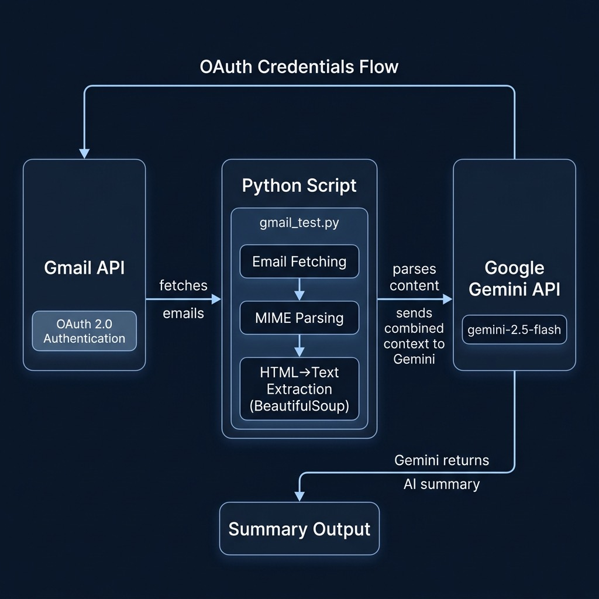
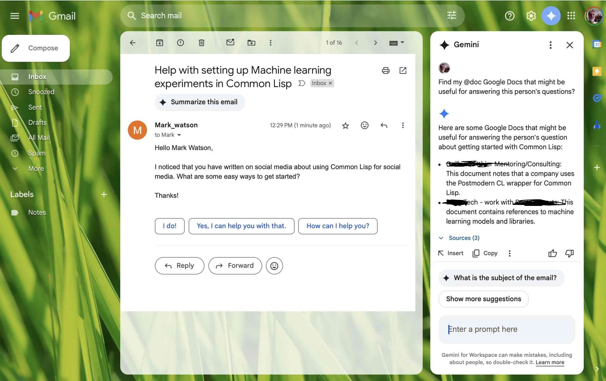
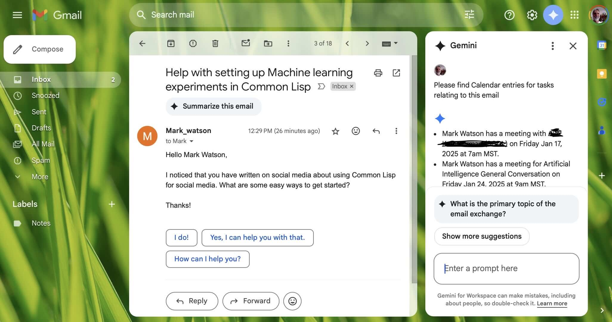
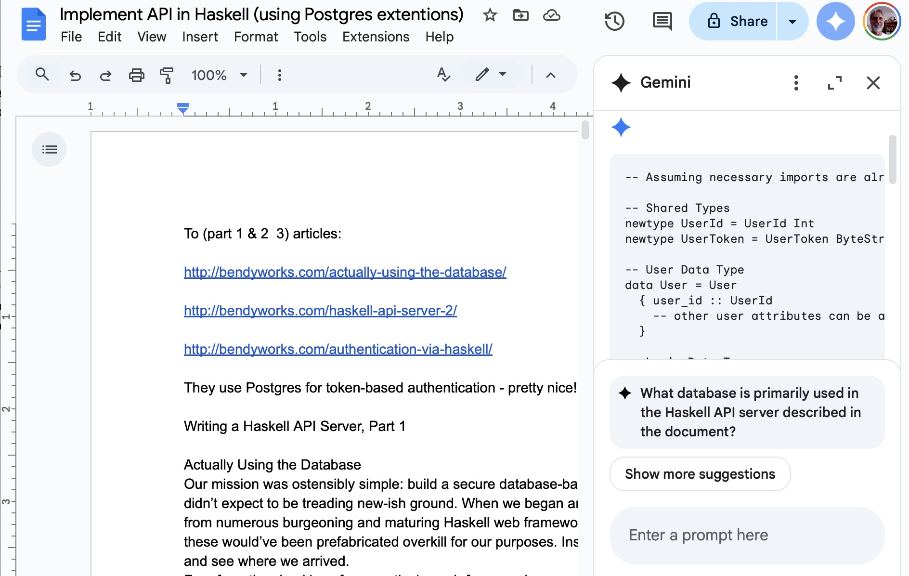
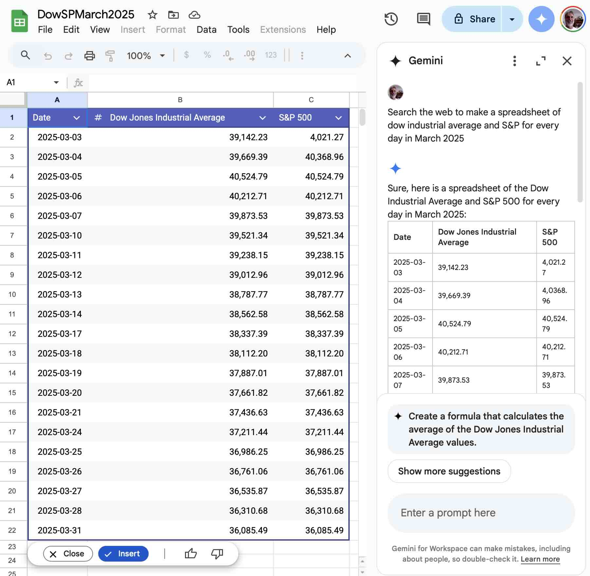

# Gemini in Gmail, Google Docs, Google Sheets, Google Drive, and Google Calendar



This chapter has two halves. The first half shows Gemini inside the Google web apps, with no code. The second half, for readers who program, does the same kind of work from a short Python script that reads your Gmail and asks Gemini for a summary.

## Which Accounts Get Gemini Inside the Apps

As I write this in November 2026, how much Gemini you see inside Gmail, Docs, and Sheets depends on your account:

- **Free personal accounts** get a few Gemini features in Gmail, such as thread summaries and suggested replies (US only at the time of writing), and the Gemini app can read your Gmail, Drive, and Calendar once you connect them.
- **Google AI Plus, Pro, and Ultra** subscriptions add Gemini inside the apps for personal accounts: the Gemini side panel, "Help me write" in Docs, Gemini in Sheets, and proofreading in Gmail. The paid plans have monthly limits on these features.
- **Google Workspace** business accounts get the same features under their organization's plan and admin settings.

Google moves features between tiers often, so check the plan page for your account before you rely on a specific feature. The examples below use my Google AI Pro account.

## Combining Gemini in Gmail with Google Docs, Drive, and Calendar

Gemini in Gmail can reach beyond the message you are reading:

- **Google Docs and Drive:** Gemini can find and summarize your files in Google Drive, including Google Docs, from inside Gmail.
- **Google Calendar:** You can ask Gemini in Gmail about events on your calendar or ask it to create new events.
- **Google Sheets and Slides:** The deepest support is in Docs, but Gemini also works in Sheets (analyzing data, building tables) and Slides (creating slides) through the side panel in those apps.

A while ago I received a request for [free mentoring](https://markwatson.com/#mentoring). While I was reading this person's email, I opened Gemini inside Gmail and prompted "Find my @doc Google Docs that might be useful for answering this person's questions."

That surfaced two notes in Google Docs that were relevant to the mentoring request. I didn't want to use this person's email as a book example, so I sent myself a similar question, opened that email in Gmail, and opened Gemini. Again I used the prompt "Find my @doc Google Docs that might be useful for answering this person's questions." Here is the screenshot:




## Combining Gemini with Google Calendar and Gmail

In Gmail, Gemini can summarize email threads, draft replies that fit the thread, and pull out action items. It also links email to scheduling: it can spot meeting details in an email, help you create the matching Google Calendar event, and check availability, including on calendars shared with you (like my wife Carol's calendar and mine).

The following example uses the same test email, but now the prompt is "Please find Calendar entries for tasks relating to this email". Here are the calendar entries it found:



## Using Gemini in a Google Doc Specifying a Design Document for a New Software Project

Gemini in Google Docs puts a writing assistant in the side panel and in the "Help me write" menu. It can draft text, outlines, or summaries, rewrite a selection to change its tone, length, or formality, brainstorm ideas, and create images, all without leaving the document.

Gemini can also use the contents of the open document as context. Here I opened a design document I wrote many years ago, opened Gemini, and prompted "Write the software specified in this design document in the Haskell programming language". Gemini used the text in the document to write a first Haskell implementation:

{width: "50%"}


## Using Gemini with Google Sheets

My favorite use of Gemini with Google Sheets is creating new test data sets for machine learning. Here I use a prompt to create a spreadsheet with three columns:

```text
Search the web to make a spreadsheet of dow industrial average and S&P for every day in March 2025
```

Gemini searched the web and created this table.



I used the **File -> Download -> Comma Separated Values (CSV)** menu to save the file on my laptop.

Check numbers that Gemini finds on the web before you use them for anything that matters. Spot check a few rows against a source you trust. In this case the cost of a wrong number is a slightly odd test data set, which is acceptable. In a client report it would not be.

## Doing the Same from Python

The web apps are the right tool when you work one email at a time. A script is the right tool when you want the same summary every morning without opening anything. The example in `source-code/9_optional_google_apps` reads your recent Gmail and asks Gemini for a short summary with action items.

This example needs two kinds of credentials:

1. **Your Gemini API key**, the same `GOOGLE_API_KEY` used in the Python chapters. It pays for the model.
2. **An OAuth token for Gmail.** Your API key does not give access to your mail. Reading mail needs your explicit approval in a browser, which Google records as an OAuth token.

### One-Time Setup

You do these steps once, in the [Google Cloud Console](https://console.cloud.google.com/):

1. Create a project, or pick the one AI Studio created for your API key.
2. Open **APIs & Services**, then **Library**, and enable the **Gmail API**.
3. Open **Google Auth Platform** (older guides call it the "OAuth consent screen"). Under **Branding**, give the app a name. Under **Audience**, choose **External**, leave the app in **Testing**, and add your own Gmail address as a **test user**.
4. Under **Clients**, create an OAuth client of type **Desktop app**. Download its JSON file into the example directory as `client_secret.json`.

Then run the helper script once:

```bash
cd source-code/9_optional_google_apps
uv sync
uv run python create_gmail_token.py
```

A browser window opens and asks you to approve read-only access to your Gmail. The script then saves a token to `~/.gmail_token.json`:

```python
SCOPES = ["https://www.googleapis.com/auth/gmail.readonly"]
CLIENT_SECRET = pathlib.Path("client_secret.json")
TOKEN_PATH = pathlib.Path.home() / ".gmail_token.json"

if not CLIENT_SECRET.exists():
    sys.exit(f"Missing {CLIENT_SECRET}. Download it from the Google Cloud Console.")

flow = InstalledAppFlow.from_client_secrets_file(CLIENT_SECRET, scopes=SCOPES)
creds = flow.run_local_server(port=0)

TOKEN_PATH.write_text(creds.to_json())
os.chmod(TOKEN_PATH, 0o600)
print(f"Saved token to {TOKEN_PATH}")
```

The scope `gmail.readonly` is the important line. It lets the script read your mail but never send, change, or delete it. Ask for the narrowest scope that does the job. `os.chmod(TOKEN_PATH, 0o600)` makes the token file readable only by you. Treat both `client_secret.json` and the token file like passwords.

### The Summarizer

`summarize_gmail.py` loads the token, refreshing it when it has expired:

```python
def load_credentials():
    """Load the saved OAuth token, refreshing it if it has expired."""
    if not TOKEN_PATH.exists():
        sys.exit(f"No token at {TOKEN_PATH}. Run create_gmail_token.py first.")
    creds = Credentials.from_authorized_user_file(str(TOKEN_PATH), SCOPES)
    if not creds.valid:
        if creds.expired and creds.refresh_token:
            creds.refresh(Request())
            TOKEN_PATH.write_text(creds.to_json())
        else:
            sys.exit(f"The token in {TOKEN_PATH} is not usable. Run create_gmail_token.py again.")
    return creds
```

Emails arrive in several formats. A message can be plain text, HTML, or a tree of parts that holds both. `extract_body` walks that tree, returns the first plain text part it finds, and falls back to HTML, which BeautifulSoup turns into text:

```python
def decode(data):
    return base64.urlsafe_b64decode(data).decode("utf-8", errors="replace")


def extract_body(payload):
    """Return the text of a Gmail message payload, preferring text/plain."""
    if payload.get("mimeType") == "text/plain" and "data" in payload.get("body", {}):
        return decode(payload["body"]["data"])

    for part in payload.get("parts", []):
        text = extract_body(part)
        if text:
            return text

    if payload.get("mimeType") == "text/html" and "data" in payload.get("body", {}):
        return BeautifulSoup(decode(payload["body"]["data"]), "html.parser").get_text()

    return ""
```

`errors="replace"` matters more than it looks. Some mail is not valid UTF-8, and without it one badly encoded newsletter stops the whole run.

The main function searches Gmail, collects the subject, sender, and first 2,000 characters of each message, and sends them to Gemini in one prompt:

```python
def summarize_recent_emails(gmail_service, query, max_results=5):
    """Fetch recent emails that match a Gmail search query and summarize them."""
    print(f"\n--- Summarizing Emails (Query: {query}) ---")

    results = gmail_service.users().messages().list(
        userId="me", q=query, maxResults=max_results
    ).execute()
    messages = results.get("messages", [])
    if not messages:
        print("No messages found matching the query.")
        return

    print(f"Found {len(messages)} emails. Fetching content...")
    email_contents = []
    for msg_info in messages:
        msg = gmail_service.users().messages().get(
            userId="me", id=msg_info["id"], format="full"
        ).execute()
        payload = msg.get("payload", {})
        headers = payload.get("headers", [])
        email_contents.append(
            f"--- Email ---\n"
            f"Subject: {header(headers, 'subject', 'No Subject')}\n"
            f"From: {header(headers, 'from', 'Unknown Sender')}\n\n"
            f"{extract_body(payload)[:2000]}\n"
        )

    prompt = (
        "Summarize the key points of the following emails. For each email give "
        "one line with the sender and the main point, then list any action items "
        "for me at the end.\n\n" + "\n".join(email_contents)
    )

    client = genai.Client()
    response = client.models.generate_content(model=MODEL_ID, contents=prompt)

    print("\n--- Gemini Summary ---")
    print(response.text.strip() if response.text else "Blocked or empty response.")


if __name__ == "__main__":
    gmail_service = build("gmail", "v1", credentials=load_credentials())
    summarize_recent_emails(gmail_service, "newer_than:7d", max_results=5)
```

The `query` argument uses the same search syntax as the Gmail search box, so `newer_than:7d`, `from:client@example.com`, and `is:unread label:invoices` all work. The prompt follows the advice in the prompting chapter: it names the output format (one line per email) and asks for the part you will act on (the action items).

Here is the output for two test emails I wrote for this book, one invoice reminder and one coffee invitation:

```text
--- Summarizing Emails (Query: newer_than:7d) ---
Found 2 emails. Fetching content...

--- Gemini Summary ---
**Email Summaries**
* **billing@acme.example:** Invoice INV-1043 for $1,284.50 is due this Friday.
* **pat@example.com:** Wants to meet for coffee next Tuesday or Wednesday morning to discuss the book project.

**Action Items**
* Confirm receipt of invoice INV-1043 with `billing@acme.example` (and arrange payment of $1,284.50 by Friday).
* Reply to `pat@example.com` with your availability for next Tuesday or Wednesday morning.
```

Run it from a scheduled task each morning and you have a daily inbox brief.

One privacy note. This script sends the text of your emails to the Gemini API. On the free tier of the API, Google may use your prompts to improve its products. If your mail holds client information, enable billing on the API key's project (paid use has different data terms) or keep this script to mail you are comfortable sharing.

## Wrap Up for Gemini Integration with Google Apps

I have used Gemini in Google apps since the summer of 2024, and the features have improved a lot. I now use it every day. Two habits make it useful: connect the apps you work in, so Gemini can see your mail, documents, and calendar together, and check anything Gemini finds on the web before you rely on it. When the same task repeats every day, move it to a script like the Gmail summarizer.
