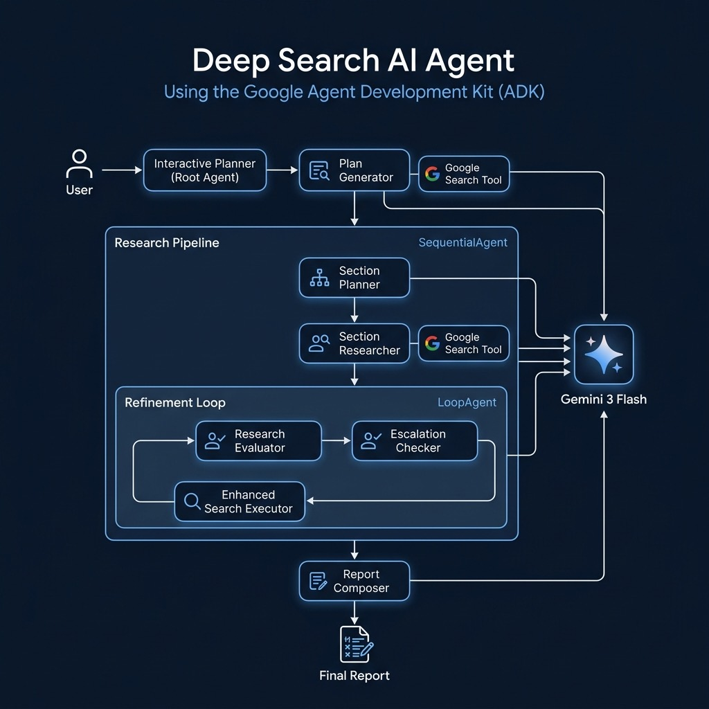

# Python Research Agent Using Google ADK



The Google Agent Development Kit (ADK) is an open-source Python framework for building multi-agent AI systems. In this chapter we build a deep research agent that plans an investigation, runs web searches, grades its own findings, and writes a report with citations. Several cooperating agents, all running on Gemini 4 Hydrogen, do the work.

## Overview of Google ADK

ADK gives you agent building blocks, `LlmAgent`, `SequentialAgent`, `LoopAgent`, and `BaseAgent`, that you combine into larger workflows. Each agent has its own instructions, optional tools (such as Google Search), and optional output schemas written as Pydantic models. Agents share data through session state, and the framework runs the event loop, calls the tools, and fires callbacks for you. That makes it straightforward to build a system where one agent plans, another researches, a third grades the quality, and a fourth writes the result.

### What Changed in ADK 2

ADK 2.0 reached general availability in May 2026, and this example uses version 2.14. The big change is a new engine underneath: ADK now runs agents as nodes in a graph, and it adds a `Workflow` class for describing those graphs directly. Three consequences matter for this chapter:

1. **The classic building blocks still work.** `LlmAgent`, `SequentialAgent`, `LoopAgent`, and custom `BaseAgent` subclasses run on the new engine. I tested the custom agent in this example, which ends a loop early, and it behaves as it did in ADK 1.
2. **`SequentialAgent` and `LoopAgent` are deprecated in favor of `Workflow`.** ADK prints a warning when you create them. The same warning says that a `Workflow` cannot yet be the sub-agent of an `LlmAgent`, and this example needs exactly that: the root agent talks to you and then hands off to the research pipeline. So the example keeps the classic classes and hides the warning. When ADK lifts that limit, the pipeline should move to a `Workflow`.
3. **ADK still requires `google-genai` older than 3.0.** The Python chapters in Part 2 use version 3 of the Gemini SDK. This project pins version 2, because ADK 2.14 declares `google-genai<3`. Every example directory has its own virtual environment, so the two versions never meet.

## Research Agent

The example lives in `source-code/a_google_adk_example`. It needs Python 3.12 or newer and the `google-adk` package, which installs its own copy of the Gemini SDK:

```bash
cd source-code/a_google_adk_example
uv sync
uv run python deep_search.py
```

I rewrote Google's full research agent web app example as a command line program. The listing below is the complete agent. It defines eight agents: seven that call Gemini and one small custom agent that decides when to stop a loop.

- The `interactive_planner` root agent receives your research topic, asks the `plan_generator` for a plan, and shows the plan to you.
- When you approve, it hands off to the `research_pipeline`.
- Inside the pipeline, the `section_planner` outlines the report and the `section_researcher` runs Google searches and summarizes what it finds.
- A loop then runs the `research_evaluator`, which grades the coverage, the `escalation_checker`, which ends the loop on a passing grade, and the `enhanced_search_executor`, which fills gaps. The loop runs at most three times.
- Finally, the `report_composer` writes a Markdown report with inline source citations.

```python
# Derived from: https://github.com/google/adk-samples/tree/main/python/agents/deep-search

import asyncio
import datetime
import re
import warnings
from typing import AsyncGenerator, Literal

from google.adk.agents import BaseAgent, LlmAgent, LoopAgent, SequentialAgent
from google.adk.agents.callback_context import CallbackContext
from google.adk.agents.context_cache_config import ContextCacheConfig
from google.adk.agents.invocation_context import InvocationContext
from google.adk.apps.app import App
from google.adk.events import Event, EventActions
from google.adk.planners import BuiltInPlanner
from google.adk.runners import InMemoryRunner
from google.adk.tools import google_search
from google.adk.tools.agent_tool import AgentTool
from google.genai import types as genai_types
from pydantic import BaseModel, Field

# ADK 2 deprecates SequentialAgent and LoopAgent in favor of Workflow, but a
# Workflow cannot yet be the sub-agent of an LlmAgent, which this design needs.
warnings.filterwarnings("ignore", message=".*is deprecated in favor of Workflow.*")

# Google ships new models several times a year. See the model naming note in
# python_auth_setup.md when this model ID stops working.
MODEL_NAME = "gemini-4-hydrogen"


# --- Structured Outputs ---
class SearchQuery(BaseModel):
    search_query: str = Field(description="A specific, targeted query for web search.")


class Feedback(BaseModel):
    grade: Literal["pass", "fail"]
    comment: str
    follow_up_queries: list[SearchQuery] | None = Field(default=None)


# --- Callbacks ---
def collect_sources(callback_context: CallbackContext) -> None:
    """Give each web source found by Google Search a short ID such as src-1."""
    state = callback_context.state
    url_map = state.get("url_to_short_id", {})
    sources = state.get("sources", {})

    for event in callback_context.session.events:
        if not (md := event.grounding_metadata):
            continue
        for chunk in md.grounding_chunks or []:
            if not chunk.web or chunk.web.uri in url_map:
                continue
            short_id = f"src-{len(url_map) + 1}"
            url_map[chunk.web.uri] = short_id
            sources[short_id] = {
                "title": chunk.web.title or chunk.web.domain,
                "url": chunk.web.uri,
            }

    state["url_to_short_id"] = url_map
    state["sources"] = sources


def replace_citations(callback_context: CallbackContext) -> genai_types.Content:
    """Turn <cite source="src-1" /> tags into Markdown links."""
    text = callback_context.state.get("final_cited_report", "")
    sources = callback_context.state.get("sources", {})

    def replacer(match):
        info = sources.get(match.group(1))
        return f" [{info['title']}]({info['url']})" if info else ""

    text = re.sub(r'\s*<cite\s+source\s*=\s*["\']?(src-\d+)["\']?\s*/>', replacer, text)
    text = re.sub(r"\s+([.,;:])", r"\1", text)
    return genai_types.Content(parts=[genai_types.Part(text=text)])


# --- Agents ---

# 1. Plan Generator: Creates the initial strategy
plan_generator = LlmAgent(
    model=MODEL_NAME,
    name="plan_generator",
    tools=[google_search],
    instruction=f"""
    Create a 5-step research plan.
    Prefix every step with either:
    - **`[RESEARCH]`**: For information gathering.
    - **`[DELIVERABLE]`**: For synthesis/output creation.

    Start with 5 `[RESEARCH]` goals. If these imply a specific output (like a table), add a `[DELIVERABLE][IMPLIED]` step immediately after.
    If refining a plan based on feedback, mark changes with `[MODIFIED]` or `[NEW]`.
    Only use search if strictly necessary to clarify ambiguous topics.
    Date: {datetime.date.today().isoformat()}
    """,
)

# 2. Section Planner: Outlines the report structure
section_planner = LlmAgent(
    model=MODEL_NAME,
    name="section_planner",
    output_key="report_sections",
    instruction="""
    Using the 'research_plan', design a Markdown outline (4-6 sections) for the final report.
    Do not include a References section.
    Format: # Section Name \n Brief overview...
    """,
)

# 3. Researcher: The heavy lifter (Search -> Synthesize)
section_researcher = LlmAgent(
    model=MODEL_NAME,
    name="section_researcher",
    tools=[google_search],
    output_key="section_research_findings",
    after_agent_callback=collect_sources,
    planner=BuiltInPlanner(thinking_config=genai_types.ThinkingConfig(include_thoughts=True)),
    instruction="""
    Execute the `research_plan` in two strict phases:

    **Phase 1: Research**
    Process all `[RESEARCH]` goals first. For each, generate 4-5 search queries, execute them, and summarize findings. Store these summaries internally.

    **Phase 2: Synthesis**
    Once Phase 1 is complete, process `[DELIVERABLE]` goals.
    Use the stored summaries to build the requested artifacts (tables, reports, etc).
    Do NOT search during this phase.

    Final output must include all research summaries and deliverable artifacts.
    """,
)

# 4. Evaluator: Checks quality
research_evaluator = LlmAgent(
    model=MODEL_NAME,
    name="research_evaluator",
    output_key="research_evaluation",
    output_schema=Feedback,
    instruction="""
    Evaluate 'section_research_findings'.
    Pass if coverage is comprehensive. Fail if there are gaps.
    If Fail, provide 'follow_up_queries' to fix the gaps.
    """,
)

# 5. Search Executor: Fixes gaps found by Evaluator
enhanced_search_executor = LlmAgent(
    model=MODEL_NAME,
    name="enhanced_search_executor",
    tools=[google_search],
    output_key="section_research_findings",
    after_agent_callback=collect_sources,
    instruction="""
    You are fixing a failed research attempt.
    1. Execute all 'follow_up_queries' from the evaluation.
    2. Synthesize new findings and merge them into 'section_research_findings'.
    """,
)


# 6. Escalation Checker: Breaks the loop if Passed
class EscalationChecker(BaseAgent):
    async def _run_async_impl(self, ctx: InvocationContext) -> AsyncGenerator[Event, None]:
        result = ctx.session.state.get("research_evaluation", {})
        if result.get("grade") == "pass":
            yield Event(author=self.name, actions=EventActions(escalate=True))
        else:
            yield Event(author=self.name)


# 7. Composer: Writes final report with citations
report_composer = LlmAgent(
    model=MODEL_NAME,
    name="report_composer",
    output_key="final_cited_report",
    after_agent_callback=replace_citations,
    instruction="""
    Write a professional report that follows this outline:
    {report_sections}

    Base it on these research findings:
    {section_research_findings}

    **CITATIONS:** These are the available sources, keyed by ID:
    {sources?}
    After each claim that comes from a source, cite it with `<cite source="src-ID" />`,
    using only IDs from the list above.
    Do not create a bibliography; use inline citations only.
    """,
)

# --- Pipelines ---

research_pipeline = SequentialAgent(
    name="research_pipeline",
    description="Executes plan, refines via loop, writes report.",
    sub_agents=[
        section_planner,
        section_researcher,
        LoopAgent(
            name="refinement_loop",
            max_iterations=3,
            sub_agents=[
                research_evaluator,
                EscalationChecker(name="escalation_checker"),
                enhanced_search_executor,
            ],
        ),
        report_composer,
    ],
)

# The Root Agent: Interfaces with the user
interactive_planner = LlmAgent(
    name="interactive_planner",
    model=MODEL_NAME,
    output_key="research_plan",
    tools=[AgentTool(plan_generator)],
    sub_agents=[research_pipeline],
    instruction="""
    You are a research assistant.
    1. Receive user topic.
    2. Call `plan_generator` to create a plan.
    3. Show plan to user.
    4. If user requests changes, call `plan_generator` again.
    5. If user agrees, delegate to `research_pipeline`.
    """,
)

# --- Application ---
# Each agent transfer changes the system instruction, so give each agent its
# own context cache instead of resending the whole prompt after a transfer.
app = App(
    root_agent=interactive_planner,
    name="DeepSearchApp",
    context_cache_config=ContextCacheConfig(),
)


async def main():
    print("\n--- Deep Search Agent ---")
    topic = input("Enter the research topic: ")

    runner = InMemoryRunner(app=app)
    user_id, session_id = "cli_user", "cli_session"
    await runner.session_service.create_session(
        app_name=app.name, user_id=user_id, session_id=session_id
    )

    current_input = topic
    while True:
        message = genai_types.Content(role="user", parts=[genai_types.Part(text=current_input)])
        last_author = None
        report = None
        async for event in runner.run_async(
            user_id=user_id, session_id=session_id, new_message=message
        ):
            if not (event.content and event.content.parts):
                continue
            for part in event.content.parts:
                # Skip the model's internal reasoning and tool calls.
                if not part.text or part.thought:
                    continue
                # replace_citations sends a second copy of the report with
                # links in place of cite tags. Keep only the last copy.
                if event.author == report_composer.name:
                    report = part.text
                    continue
                if event.author != last_author:
                    print(f"\n\n[{event.author}]")
                    last_author = event.author
                print(part.text, end="", flush=True)

        if report:
            print(f"\n\n[{report_composer.name}]\n{report}")

        current_input = input(
            "\n\n(Enter to continue, or type feedback. Type 'quit' to exit)\n> "
        ).strip()
        if current_input.lower() in ("quit", "exit"):
            break
        current_input = current_input or "proceed"


if __name__ == "__main__":
    try:
        asyncio.run(main())
    except (KeyboardInterrupt, EOFError):
        print("\nExiting...")
```

## How the Pieces Fit

**Shared state.** Agents pass work to each other through session state. An agent with `output_key="report_sections"` saves its answer under that key. Another agent's instruction can then include `{report_sections}`, and ADK replaces it with the saved text before calling the model. The report composer uses this to see the outline, the findings, and the list of sources. The question mark in `{sources?}` tells ADK to insert nothing, rather than fail, if no sources exist yet.

**Structured output.** The evaluator has `output_schema=Feedback`, so its answer must match the Pydantic class: a `grade` of `"pass"` or `"fail"`, a comment, and a list of follow-up queries. The `EscalationChecker` reads that grade from state. When the grade is pass, it yields an event with `escalate=True`, which ends the `LoopAgent` early.

**Citations.** Gemini's Google Search tool returns *grounding metadata*: the web pages it used. After each search agent finishes, the `collect_sources` callback gives each new page a short ID such as `src-1` and saves the list in state. The composer's instruction includes that list and asks for `<cite source="src-1" />` tags after each sourced claim. Its callback, `replace_citations`, then swaps each tag for a Markdown link. The links point to Google's grounding redirect URLs, which forward to the original pages.

An earlier version of this example did not show the composer the list of sources. The model then invented source IDs or left the tags out, and the finished report had almost no working links. If you adapt this pattern, always put the valid IDs in the prompt. Even with the list, how often the model cites is up to the model: in my test runs, Hydrogen cited a few key facts rather than every number. If you need a citation on every statistic, say so in the instruction and check the output.

**Two copies of the report.** When an `after_agent_callback` returns content, ADK sends it as a new event. So the composer's report arrives twice: first with the raw cite tags, then with the links. The main loop keeps only the last copy and prints it once at the end.

**Context caching.** Each handoff between agents changes the system instruction, so without help every handoff resends the whole conversation at full price. `ContextCacheConfig()` on the `App` gives each agent its own prompt cache. ADK prints a warning that suggests this setting if you leave it out.

**Thoughts.** The section researcher uses `BuiltInPlanner` with `include_thoughts=True`, so its events include the model's reasoning summaries. The main loop skips parts marked `part.thought`, so you see only the real output. Print them if you want to watch the researcher think.

## A Sample Session

Here is the start of a session on the topic "The market for standing desks for home offices in 2026". The planner shows its plan and waits:

```text
[interactive_planner]
Here is the research plan for **The market for standing desks for home offices in 2026**:

1. **`[RESEARCH]`** Gather market size, valuation, unit volume, and 2026 growth projections (CAGR) for the global and US standing desk market, specifically isolating the residential and home office segment from commercial office demand.
2. **`[RESEARCH]`** Investigate 2026 demand drivers and buyer trends, including remote and hybrid work adoption rates, corporate home-office equipment stipends, and consumer focus on ergonomics and sedentary-health mitigation.
...
Would you like to proceed with this plan, or would you like to request any changes?

(Enter to continue, or type feedback. Type 'quit' to exit)
>
```

After I pressed Enter, the pipeline ran with no further input. The output shows each agent as it takes its turn, `[section_planner]`, `[section_researcher]`, `[research_evaluator]`, and finally `[report_composer]` with the finished report. In this run the evaluator passed the research on the first try, so the search executor never ran. The whole session took a few minutes.

The deep search agent shows several patterns that are useful in any agent system: break a complex task into focused agents, use Pydantic schemas as contracts between agents, let an evaluator decide whether to loop, and track where each fact came from. The same patterns fit competitive analysis, literature reviews, market research, or any task where repeated search and synthesis beats a single LLM call.

## Keeping This Example Working

Agent frameworks change quickly, and this chapter depends on two of them: `google-adk` and the Gemini SDK that it installs. Two habits keep the example running:

1. **Check that the code still loads before you run a session.** Change into `source-code/a_google_adk_example` and run:

    ```bash
    uv sync
    uv run python -c "import deep_search; print('root agent:', deep_search.app.root_agent.name)"
    ```

    This builds every agent and prints the root agent name without calling the model. It catches a removed class or a changed import in a few seconds, which is far cheaper than finding it in the middle of a research session.

2. **Treat the model name as data.** `MODEL_NAME` is one constant at the top of the file. When Google ships a newer model, change that line. The model naming note in the authentication chapter explains stable and preview names.

The `source-code/` directory has a `make verify` target that runs checks like this one for every chapter, and a GitHub Actions workflow runs it on each push. If you copy these examples into your own project, copy that habit too.
