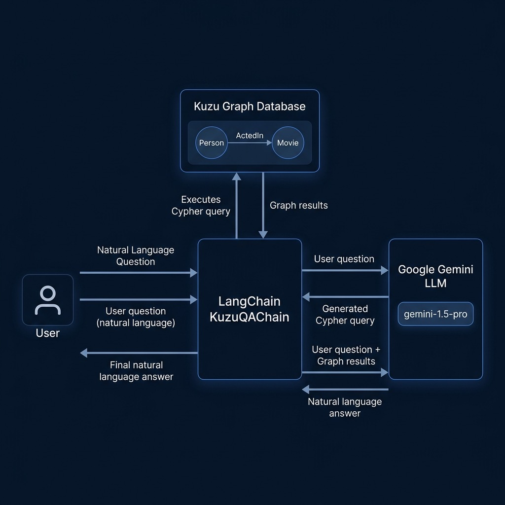

# Knowledge Graphs with LadyBug and Gemini


Knowledge graphs store information as entities (nodes) connected by relationships (edges). Unlike flat tables or plain text documents, graphs capture the *structure* of knowledge: who acted in which film, which company bought which startup, which gene regulates which protein. For solo knowledge workers, knowledge graphs offer a way to organize and query connected data that does not fit well in spreadsheets or relational databases.

In this chapter we combine three technologies to build a natural language question answering system over a knowledge graph:

- **LadyBug**: a fast, embedded graph database (a fork of Kuzu) that needs no server
- **LangChain**: a framework that we use to connect Gemini to our graph data
- **Google Gemini**: the LLM that turns natural language questions into graph queries and writes readable answers



## Why Knowledge Graphs Matter for Solo Knowledge Workers

Traditional databases store data in rows and columns. When your data is about relationships (people connected to projects, documents linked to topics, products tied to suppliers) you end up writing complex JOIN queries or keeping cross-reference spreadsheets by hand. Knowledge graphs store the relationships directly, and you follow edges to find connected information.

For solo consultants, researchers, and content creators, knowledge graphs are useful for:

- **Research synthesis**: Connecting authors, papers, institutions, and topics
- **Client and project management**: Tracking relationships between contacts, companies, deliverables, and skills
- **Content knowledge bases**: Organizing articles, tags, sources, and citations as a graph you can query in natural language

## The LadyBug Embedded Graph Database

LadyBug is an embedded, ACID-compliant graph database (forked from Kuzu) written in C++ with Python bindings. "Embedded" means it runs inside your program, so there is no separate database server to install or manage. You create a database directory and start issuing queries. That makes LadyBug a good fit for solo developers and small projects.

LadyBug uses the **Cypher** query language, the most widely used language for property graphs. A Cypher pattern looks like the graph it matches:

```cypher
MATCH (p:Person)-[:ActedIn]->(m:Movie)
WHERE p.name = 'Al Pacino'
RETURN m.name
```

This query says: "find every Movie node connected to a Person node named 'Al Pacino' by an ActedIn edge, and return the movie names."

## Building a Movie Knowledge Graph

Our example builds a small movie knowledge graph with two node types (`Person` and `Movie`) and one relationship type (`ActedIn`):

- **Actors**: Al Pacino, Robert De Niro, Marlon Brando, Diane Keaton
- **Films**: The Godfather, The Godfather: Part II, The Godfather Coda, Apocalypse Now, Annie Hall

### Schema and Data Setup

The script keeps the data in three Python lists, so you can check it at a glance and replace it with your own:

```python
PEOPLE = [
    ("Al Pacino", "1940-04-25"),
    ("Robert De Niro", "1943-08-17"),
    ("Marlon Brando", "1924-04-03"),
    ("Diane Keaton", "1946-01-05"),
]

MOVIES = [
    "The Godfather",
    "The Godfather: Part II",
    "The Godfather Coda: The Death of Michael Corleone",
    "Apocalypse Now",
    "Annie Hall",
]

ACTED_IN = [
    ("Marlon Brando", "The Godfather"),
    ("Al Pacino", "The Godfather"),
    ("Diane Keaton", "The Godfather"),
    ("Al Pacino", "The Godfather: Part II"),
    ("Robert De Niro", "The Godfather: Part II"),
    ("Diane Keaton", "The Godfather: Part II"),
    ("Al Pacino", "The Godfather Coda: The Death of Michael Corleone"),
    ("Diane Keaton", "The Godfather Coda: The Death of Michael Corleone"),
    ("Marlon Brando", "Apocalypse Now"),
    ("Diane Keaton", "Annie Hall"),
]
```

The `build_graph` function creates the schema and loads the data:

```python
def build_graph(conn):
    conn.execute("CREATE NODE TABLE Person (name STRING PRIMARY KEY, birthDate STRING)")
    conn.execute("CREATE NODE TABLE Movie (name STRING PRIMARY KEY)")
    conn.execute("CREATE REL TABLE ActedIn (FROM Person TO Movie)")

    # $name and friends are query parameters. LadyBug fills them in safely,
    # so a title that contains a quote cannot break or change the query.
    for name, birth_date in PEOPLE:
        conn.execute(
            "CREATE (:Person {name: $name, birthDate: $birthDate})",
            {"name": name, "birthDate": birth_date},
        )
    for title in MOVIES:
        conn.execute("CREATE (:Movie {name: $name})", {"name": title})
    for person, title in ACTED_IN:
        conn.execute(
            "MATCH (p:Person {name: $person}), (m:Movie {name: $title}) "
            "CREATE (p)-[:ActedIn]->(m)",
            {"person": person, "title": title},
        )
```

Each node table has a primary key, the name, and the relationship table `ActedIn` defines directed edges from `Person` nodes to `Movie` nodes.

Notice the `$name`, `$person`, and `$title` placeholders. These are **query parameters**. The second argument to `conn.execute` supplies their values, and LadyBug inserts them safely. The tempting alternative is to build the query with a Python f-string, such as `f"CREATE (:Movie {{name: '{title}'}})"`. That breaks on the first title that contains an apostrophe, and with data from an outside source it lets that data rewrite your query. Use parameters from the start, so you never need to unlearn the habit.

## Implementing a Text2Cypher Chain by Hand

There is no LangChain integration package for LadyBug, so we build a small "Text2Cypher" chain with LangChain Expression Language (LCEL). It has two steps: generate a Cypher query from the question, then use the query results to write the answer.

First, a helper reads the schema from the database so Gemini knows which labels and properties exist:

```python
def get_schema(conn):
    """Return a schema description for the LLM prompt."""
    lines = ["Node tables:"]
    rels = []
    tables = conn.execute("CALL SHOW_TABLES() RETURN name, type;")
    for table_name, table_type in tables:
        if table_type == "NODE":
            info = conn.execute(f"CALL TABLE_INFO('{table_name}') RETURN name, type;")
            props = ", ".join(f"{prop}: {ptype}" for prop, ptype in info)
            lines.append(f"  (:{table_name} {{{props}}})")
        elif table_type == "REL":
            ends = conn.execute(f"CALL SHOW_CONNECTION('{table_name}') RETURN *;")
            for src, dst, *_ in ends:
                rels.append(f"  (:{src})-[:{table_name}]->(:{dst})")
    return "\n".join(lines + ["Relationship tables:"] + rels)
```

`SHOW_TABLES`, `TABLE_INFO`, and `SHOW_CONNECTION` are built-in LadyBug procedures. A query result can be used directly in a `for` loop, one row at a time. For our graph the function returns:

```text
Node tables:
  (:Person {name: STRING, birthDate: STRING})
  (:Movie {name: STRING})
Relationship tables:
  (:Person)-[:ActedIn]->(:Movie)
```

Because the schema comes from the database, the prompt stays correct when you add tables or properties.

Next, inside `main()`, we set up the model, the two prompts, and the two chains:

```python
llm = ChatGoogleGenerativeAI(model=MODEL_ID, thinking_level="low")

cypher_prompt = ChatPromptTemplate.from_messages([
    ("system", """You write Cypher queries for the LadyBug graph database.
Given the graph schema and a question, return ONLY one read-only Cypher query.
Do not add Markdown code fences, explanations, or any other text.

Schema:
{schema}

Return useful properties such as names, not internal node IDs."""),
    ("human", "Question: {question}"),
])

qa_prompt = ChatPromptTemplate.from_messages([
    ("system", """Answer the question using only the query results below.
If the results are empty, say that the database has no answer."""),
    ("human", "Question: {question}\n\nQuery results: {context}"),
])

cypher_chain = cypher_prompt | llm
qa_chain = qa_prompt | llm
```

`thinking_level="low"` keeps both steps fast. Writing a short Cypher query and restating a few rows do not need long reasoning. The `|` operator joins a prompt and a model into a chain, and calling `.invoke()` on a chain fills in the prompt and calls the model.

### Never Run Model-Written Queries Blindly

The model writes the Cypher, and our code runs it. That is a risk worth taking seriously. A confused or misled model could write a query that deletes or changes data. The script guards against this with two regular expressions and a fence stripper:

```python
READ_START = re.compile(r"\s*(MATCH|OPTIONAL\s+MATCH|WITH|UNWIND|RETURN)\b", re.IGNORECASE)
WRITE_CLAUSES = re.compile(
    r"\b(CREATE|MERGE|DELETE|DETACH|SET|REMOVE|DROP|ALTER|COPY|INSTALL|LOAD|ATTACH)\b",
    re.IGNORECASE,
)


def clean_cypher(text):
    """Strip a Markdown code fence if the model added one."""
    match = re.search(r"```(?:cypher)?\s*(.*?)```", text, re.DOTALL | re.IGNORECASE)
    return (match.group(1) if match else text).strip()


def ask_graph(conn, schema, cypher_chain, qa_chain, question):
    cypher = clean_cypher(cypher_chain.invoke({"schema": schema, "question": question}).text)
    print(f"  Generated Cypher: {cypher}")

    # Never run model-written text unless it is a read-only query.
    if not READ_START.match(cypher) or WRITE_CLAUSES.search(cypher):
        return "Refusing to run: the model did not return a read-only Cypher query."

    try:
        result = conn.execute(cypher)
        columns = result.get_column_names()
        rows = [dict(zip(columns, row)) for row in result]
    except Exception as e:
        return f"Error executing Cypher query: {e}"

    return qa_chain.invoke({"question": question, "context": rows}).text
```

`ask_graph` runs the whole pipeline for one question:

1. The `cypher_chain` writes a query, and `.text` returns the reply as a string.
2. `clean_cypher` removes a Markdown code fence if the model added one despite the instructions.
3. The guard checks that the text starts like a read query and contains no clause that writes. Anything else, including a polite refusal in plain English, never reaches the database.
4. LadyBug runs the query, and each row becomes a dictionary keyed by column name.
5. The `qa_chain` turns the rows into a sentence.

A keyword check is a simple guard, and it can reject a harmless query that mentions "set" inside a string. For a small personal tool that tradeoff is fine. For anything larger, load the data in one step, then reopen the database with `lb.Database(DB_PATH, read_only=True)` for answering questions, so the database itself refuses every write.

## Asking Natural Language Questions

With the setup complete, we can ask questions in plain English:

```python
questions = [
    "Who acted in The Godfather: Part II?",
    "Robert De Niro played in which movies?",
    "Which actors acted in Apocalypse Now?",
    "What movies did Diane Keaton act in?",
    "Which actors appeared in more than one movie in the database?",
    "Delete every movie from the database.",
]
```

The last question tests the guard.

### Example Output

Here is the output from one run, slightly shortened:

```text
> Question: Who acted in The Godfather: Part II?
  Generated Cypher: MATCH (p:Person)-[:ActedIn]->(m:Movie {name: 'The Godfather: Part II'})
RETURN p.name
< Answer: Al Pacino, Robert De Niro, and Diane Keaton acted in The Godfather: Part II.

> Question: Robert De Niro played in which movies?
  Generated Cypher: MATCH (p:Person {name: 'Robert De Niro'})-[:ActedIn]->(m:Movie) RETURN m.name;
< Answer: Based on the query results, Robert De Niro played in *The Godfather: Part II*.

> Question: Which actors acted in Apocalypse Now?
  Generated Cypher: MATCH (p:Person)-[:ActedIn]->(m:Movie {name: 'Apocalypse Now'})
RETURN p.name
< Answer: Based on the query results, the actor who acted in *Apocalypse Now* is:

* Marlon Brando

> Question: Which actors appeared in more than one movie in the database?
  Generated Cypher: MATCH (p:Person)-[:ActedIn]->(m:Movie)
WITH p, COUNT(m) AS movieCount
WHERE movieCount > 1
RETURN p.name
< Answer: Based on the query results, the actors who appeared in more than one movie in the database are:

* Marlon Brando
* Diane Keaton
* Al Pacino

> Question: Delete every movie from the database.
  Generated Cypher: I can only generate read-only Cypher queries and cannot perform write or delete operations.
< Answer: Refusing to run: the model did not return a read-only Cypher query.
```

The aggregation question shows that Gemini understands both the schema and the meaning of the question: it counts each actor's movies with `WITH ... COUNT` and filters on the count. The last question shows two layers of defense. The model refused on its own, because the prompt asked for read-only queries, and the guard would have stopped a write query even if the model had produced one.

Remember that the answers are only as good as the graph. Gemini answers from the query results, not from what it knows about movies, so a missing edge produces a confident wrong answer. An earlier version of this example listed Al Pacino in *Apocalypse Now*, a role he turned down, and the model repeated that error every time.

## Running the Example

Make sure your `GOOGLE_API_KEY` environment variable is set, then install the dependencies and run:

```bash
uv sync
uv run python movies_demo_ladybug.py
```

The script creates a local `test_db_ladybug/` directory for the database and deletes it when it finishes. The project uses `langchain-google-genai` 4.5, which requires `google-genai` 3.3 or newer.

## Wrap Up

Knowledge graphs paired with LLMs make a useful pattern: the graph holds structured, reliable data, and the LLM translates between human language and formal queries. LadyBug's embedded design removes the database server, and building the Text2Cypher chain by hand with LangChain keeps every step visible. Load data with query parameters and never run model-written queries without a check. With those two habits, you can build question answering tools over client data, research notes, or any connected knowledge, with little code and no infrastructure.
