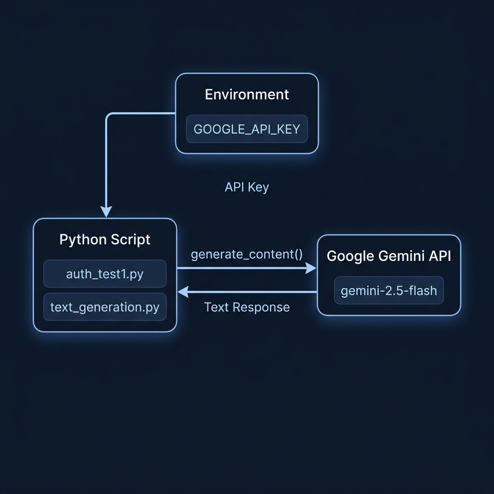

# First Steps Using Python with the Gemini Python Library



**Introduction**

This chapter covers your first steps with Google's Gemini models in Python. The Gemini API gives you access to Google's large language models from your own programs. Google provides the `google-genai` library, often called the Gemini Python SDK (Software Development Kit), to call that API from Python.

**What is an SDK?** An SDK is a set of software tools in one installable package. The Gemini Python SDK handles HTTP requests, responses, authentication, and data formatting for you, so you can focus on *what* you want the model to do rather than on the low-level details.

This chapter covers setting up your environment, installing the library, and authenticating your requests to the Gemini API. Authentication proves your identity and ties your usage to your account for billing and quota.

## Prerequisites

Before you begin coding, make sure you have the following:

1.  **Python:** This book uses Python 3.12 or newer, so every example and the Google Agent Development Kit run on one version. Check your version with `python --version` or `python3 --version` in your terminal. The next section shows how `uv` can install Python for you.
2.  **Gemini API key:** The fastest way to get a key is Google AI Studio.
    * Open the [API keys page in Google AI Studio](https://aistudio.google.com/app/api-keys) and sign in with your Google account.
    * Click **Create API key**. AI Studio creates a Google Cloud project for the key if you do not have one.
    * Copy the key.
    * **Important:** Treat your API key like a password. Keep it secure and do not put it in your source code or commit it to version control.

The free tier is enough for every example in Part 2. If you turn on billing for the project, Google may use different terms for how it handles your data, so read the terms for the tier you choose.

## Installation with `uv`

We use **uv**, a fast Python package and project manager, to install the SDK and manage virtual environments.

**What is `uv`?**
`uv` replaces `pip`, `venv`, and `pip-tools`. It runs much faster than they do and tracks your dependencies in a standard `pyproject.toml` file. It creates a separate virtual environment for each project and writes a `uv.lock` lockfile, so every install produces the same set of packages. You never need to create or activate a virtual environment by hand.

If you don't have `uv` installed yet, install it with:

```bash
curl -LsSf https://astral.sh/uv/install.sh | sh
```

**Project Setup Steps:**

1.  Create a new directory for your project and change into it.
2.  Create a bare `uv` project:
    ```bash
    uv init --bare
    ```
    This creates a `pyproject.toml` file that tracks your dependencies.
3.  Add the Gemini SDK as a dependency:
    ```bash
    uv add google-genai
    ```
    `uv` resolves the dependencies, creates a virtual environment, and writes a `uv.lock` lockfile.

`uv` uses whatever Python interpreter it finds, and it can also install one for you. The examples in this book set `requires-python = ">=3.12"` and I develop them on Python 3.14. If `uv` picks an older interpreter, ask for a specific version:

```bash
uv python install 3.14
uv sync --python 3.14
```

Every project in `source-code/` has its own virtual environment and lockfile, so nothing you install for one chapter can break another.

## Authentication: Connecting Securely

Authentication is how the Gemini API checks that a request comes from you. For development and server-side programs, the SDK uses an API key.

**Best Practice: Secure API Key Management**
**Never hardcode your API key in your source code.** If your code ever becomes public, for example in a public repository, someone can copy the key and run up charges on your account.

Store your API key in an **environment variable** instead. An environment variable lives in your operating system's environment, outside your program, and your code reads it at runtime.

**Setting the Environment Variable:**

* **Linux/macOS:**
    ```bash
    export GOOGLE_API_KEY='YOUR_API_KEY_HERE'
    ```
    (Add this line to your shell profile, such as `~/.bashrc` or `~/.zshrc`, so it persists across sessions.)
* **Windows (Command Prompt):**
    ```cmd
    set GOOGLE_API_KEY=YOUR_API_KEY_HERE
    ```
* **Windows (PowerShell):**
    ```powershell
    $env:GOOGLE_API_KEY='YOUR_API_KEY_HERE'
    ```
* **Using `.env` files:** For project-specific variables, you can keep a `.env` file in your project root and load it with the `python-dotenv` library. Install it with `uv add python-dotenv` and load it at the start of your script.

The SDK reads `GOOGLE_API_KEY` or `GEMINI_API_KEY`. The examples in this book use `GOOGLE_API_KEY`. If you set both, `GOOGLE_API_KEY` wins. Note that the Antigravity CLI, covered in Part 3, reads only `GEMINI_API_KEY`.

**Example 1: `auth_test1.py` - Basic Authentication & Setup**

This script checks that your key is set, creates a Gemini client, and lists the models you can call.

```python
# --- Example 1: Basic Authentication & Setup ---
# Purpose: Confirm that your API key works by creating a Gemini client and
#          listing the models you can call.

import os
import sys

from google import genai

# Best practice: store your API key in an environment variable rather than
# in your source code. The client reads GOOGLE_API_KEY or GEMINI_API_KEY.
# If both are set, GOOGLE_API_KEY wins.
if not (os.getenv("GOOGLE_API_KEY") or os.getenv("GEMINI_API_KEY")):
    print("Error: set the GOOGLE_API_KEY environment variable to your API key.")
    print("Create a key at https://aistudio.google.com/app/api-keys")
    sys.exit(1)

try:
    client = genai.Client()
    print(f"google-genai SDK version: {genai.__version__}")

    # The full list includes speech, embedding, and live audio models. Show
    # only the models that answer text prompts with generate_content.
    print("\nModels that support generate_content:")
    for m in client.models.list():
        if "generateContent" in (m.supported_actions or []):
            print(f"  {m.name.removeprefix('models/'):40} {m.display_name}")

except Exception as e:
    # An invalid key produces a 400 INVALID_ARGUMENT error with API_KEY_INVALID.
    print(f"An error occurred: {e}")
    sys.exit(1)
```

**Explanation:**

1.  **Imports:** `google.genai` is the SDK, imported with `from google import genai`. `os` reads environment variables and `sys` lets the script exit with an error code.
2.  **Check the key:** The script checks for a key before it creates the client, so a missing key produces a clear message rather than a stack trace.
3.  **Create the client:** `genai.Client()` with no arguments reads the key from the environment. This is the form Google's own documentation uses.
4.  **List the models:** `client.models.list()` makes a lightweight API call. A successful list proves that your key is valid. The full list holds more than sixty entries, including speech, embedding, and live audio models, so the script prints only the ones that support `generateContent`, which is the call this book uses.
5.  **Error handling:** The `except` block catches network problems and invalid keys, prints the message, and exits with an error code.

**Running the Script:**
Make sure `GOOGLE_API_KEY` is set, then run the script from your terminal with `uv run`:
```bash
uv run python auth_test1.py
```
Here is part of the output I got in November 2026:

```text
google-genai SDK version: 3.6.1

Models that support generate_content:
  gemini-2.5-flash                         Gemini 2.5 Flash
  gemini-2.5-pro                           Gemini 2.5 Pro
  gemma-4-31b-it                           Gemma 4 31B IT
  gemini-3.1-flash-lite                    Gemini 3.1 Flash Lite
  gemini-nano-banana-2.1                   Nano Banana 2.1
  gemini-3.8-flash                         Gemini 3.8 Flash
  gemini-4-argon                           Gemini 4 Argon
  gemini-4-carbon                          Gemini 4 Carbon
  gemini-4-hydrogen                        Gemini 4 Hydrogen
  gemini-4-neon                            Gemini 4 Neon
  ...
```

The list on your machine will differ, because Google adds and retires models every month.

## Making Your First API Call: Text Generation

Once you have a client, you can start using the models. Let's look at a simple text generation example.

**Example 2: `text_generation.py`**

This script sends a prompt to a Gemini model and prints the response.

```python
# --- Example 2: Text Generation ---
# Purpose: Use the Gemini client to generate text from a prompt.

from google import genai

# genai.Client() reads your key from GOOGLE_API_KEY (or GEMINI_API_KEY).
client = genai.Client()

# Google ships new models several times a year. See the model naming note in
# python_auth_setup.md when this model ID stops working.
MODEL_ID = "gemini-4-hydrogen"

# Define the prompt (your instruction to the model)
prompt = "Brainstorm 5 blog post ideas about remote work productivity for solo knowledge workers."

# Generate content by calling the model. This makes the actual API request.
response = client.models.generate_content(
    model=MODEL_ID,
    contents=prompt,
)

# Responses can be empty when safety filters block them, so check for text.
print("\n--- Blog Post Ideas ---")
if response.text:
    print(response.text)
else:
    print("Response was empty or potentially blocked.")
```

**Explanation:**

1.  **Create Client:** `genai.Client()` creates the client and reads your key from the environment.
2.  **Model ID:** `MODEL_ID` names the model once, at the top of the file. Every example in this book follows that pattern, so you have one line to change when Google ships a new model. Gemini 4 Hydrogen is Google's fast everyday model, and it has a free tier.
3.  **Define Prompt:** This is the input text you give the model.
4.  **Generate Content:** `client.models.generate_content(model=MODEL_ID, contents=prompt)` sends the prompt to the model and waits for the response.
5.  **Process Response:** The result is a response object.
    * `response.text` holds the generated text, if there is any.
    * Always check that the response has content. Safety filters or other problems can block a response.
6.  **Error Handling:** The client raises an exception when the API key is missing or invalid, or when the network is down. Wrap the call in a `try`/`except` block when you write production code, as the previous example does.

**Running the Script:**
Make sure `GOOGLE_API_KEY` is set, then run:
```bash
uv run python text_generation.py
```
Here is the start of the output:

```text
--- Blog Post Ideas ---
Here are 5 blog post ideas tailored to the specific challenges of solo knowledge workers (like freelancers, consultants, and independent remote workers):

### 1. The "CEO vs. Intern" Split: Batching Admin Work So You Can Actually Do Your Job
* **The Angle:** Solo workers have to wear every hat—doing deep, high-value client or creative work while also handling invoicing, emails, and scheduling. Context-switching between these modes destroys productivity.
...
```

## The Interactions API

Google now documents a second way to call Gemini, the **Interactions API**. Instead of `client.models.generate_content(...)` you call `client.interactions.create(...)`, and the reply text arrives in `interaction.output_text`. The main difference is that the server can keep the conversation. Each interaction has an `id`, and the next request names it with `previous_interaction_id` instead of resending the whole history.

**Example 3: `interactions_demo.py`**

```python
# --- Example 3: The Interactions API ---
# Purpose: Send the same kind of request through the Interactions API, which
#          Google now documents alongside generate_content. The API keeps the
#          conversation on the server, so a follow-up only needs the ID of
#          the previous turn.

from google import genai

client = genai.Client()

# Google ships new models several times a year. See the model naming note in
# python_auth_setup.md when this model ID stops working.
MODEL_ID = "gemini-4-hydrogen"

first = client.interactions.create(
    model=MODEL_ID,
    input="Suggest one name for a newsletter about remote work for solo consultants.",
)
print("First answer: ", first.output_text)

# The second turn refers back to the first by ID. We do not resend the
# earlier prompt or answer.
second = client.interactions.create(
    model=MODEL_ID,
    input="Write a one sentence tagline for that newsletter.",
    previous_interaction_id=first.id,
)
print("Second answer:", second.output_text)
```

The output shows that the second turn knew which newsletter "that newsletter" meant:

```text
First answer:  **The Portable Practice**

It nods to the "practice" of independent consulting while capturing the freedom and mobility of working remotely.
Second answer: Weekly insights for solo consultants building a profitable, location-independent business of one.
```

The rest of this book uses `generate_content`. It is simpler to learn, Google still supports it fully, and most code you will read uses it. Reach for the Interactions API when you want the server to hold a multi-turn conversation, or when you use Google's hosted agents such as Deep Research.

## Google's Model Naming, and What To Do When a Model ID Changes

This section is the one to reread in six months, because it is the part of the book most likely to go stale.

Google ships Gemini models on a fast schedule, and the name tells you how long a model will live:

- **Stable names** have no suffix. Gemini 3 models carry a version and a tier, such as `gemini-3.8-flash`. Gemini 4 models carry a code name instead of a tier, such as `gemini-4-hydrogen` or `gemini-4-carbon`. Google patches the model behind a stable name without changing the name. The examples in this book use stable names.
- **Preview names** end in `-preview` or a date such as `-04-2026`. Previews let developers try a model before it is finished. Google retires them first, often within a few months, and calls to a retired preview fail with an error.
- **Alias names** such as `gemini-flash-latest` point at whatever model Google picks today. They are handy in AI Studio, but they are not on the `v1` API that the SDK uses by default (see below), and the model behind them can change without notice.

The practical rule is simple. Never put a preview model or an alias in something you want to keep working. Use a stable name and update it when a new generation ships.

As I write this in November 2026, the Gemini 4 family has four GA models:

| Model ID | Use it for |
| --- | --- |
| `gemini-4-hydrogen` | Everyday work, coding, and agents. Fast, cheap, and has a free tier. The default in this book. |
| `gemini-4-neon` | Harder tasks. Google places it between Hydrogen and Carbon. |
| `gemini-4-argon` | Frontier reasoning with lower token use than Carbon. |
| `gemini-4-carbon` | Google's strongest reasoning model, for the hardest problems. |

`gemini-3.8-flash` still works and is still stable, but Google now calls it the previous generation.

Google sometimes deprecates a model by rerouting its requests to a newer one rather than failing them. For example, from December 1, 2026 requests to `gemini-2.5-pro` go to `gemini-3.8-flash`. Your code keeps running, but the answers come from a different model. Check the [release notes](https://aistudio.google.com/docs/changelog) a few times a year.

When an example in this book stops working, the error message names the problem. A retired or misspelled model produces a `404 NOT_FOUND` error. An API key problem produces `400 INVALID_ARGUMENT` with `API_KEY_INVALID`. Read the message before you change code.

To find the current model IDs, open the [models page](https://aistudio.google.com/docs/models) in Google's Gemini API documentation, or run `auth_test1.py`. Then change the one line at the top of the example:

```python
MODEL_ID = "gemini-4-hydrogen"   # replace with the current model
```

## Keeping an Eye on the SDK Version

Google released version 3.0 of `google-genai` on November 5, 2026, and the examples in this book use 3.6 or newer. Version 3 made three breaking changes:

1. **The default API version is now `v1` instead of `v1beta`.** The `-latest` aliases, context caching, and the Live API exist only on `v1beta`. If you need one of them, ask for the beta API when you create the client:

    ```python
    from google.genai import types

    client = genai.Client(http_options=types.HttpOptions(api_version="v1beta"))
    ```

    Setting the environment variable `GOOGLE_GENAI_API_VERSION=beta` does the same for every script.
2. **The SDK uses the `httpx2` HTTP library instead of `httpx`.** This only matters if you pass your own HTTP client or catch network exceptions by their `httpx` class names.
3. **One field of the Interactions API changed type.** The result of a code execution step is no longer a plain string.

None of the simple examples in this book needed changes for version 3. The lesson is the general one: Google can break a library on a major version, so pin the major version in any project you cannot afford to fix in a hurry. In `pyproject.toml` that looks like `"google-genai>=3.6.1,<4"`. One library in this book, the Agent Development Kit, still requires `google-genai` older than 3.0, so its project uses a different SDK version than the others. The ADK chapter explains this.

## Wrap Up

You have now set up your Python environment, installed the Gemini SDK with `uv`, and authenticated with the Gemini API using an API key stored in an environment variable. You have also run your first text generation request and a two-turn conversation with the Interactions API.

Using environment variables keeps your credentials out of your code. In the following chapters, we look at more features of the API and the Python SDK.
