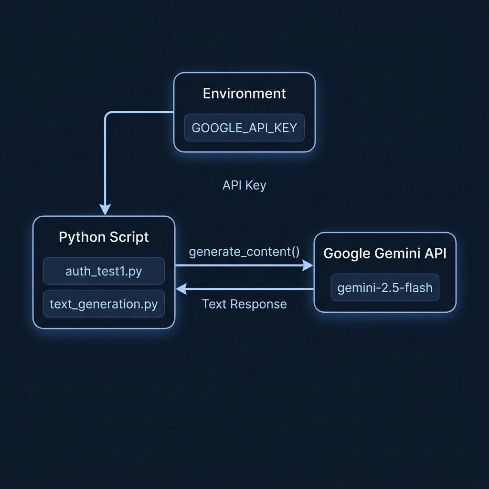

# First Steps Using Python with the Gemini Python Library



**Introduction**

Welcome to your first practical steps in harnessing the power of Google's Gemini models using Python. The Gemini API provides access to Google's state-of-the-art large language models, enabling you to integrate generative AI capabilities into your applications. To facilitate this interaction within a Python environment, Google provides the `google-genai` library, often referred to as the Gemini Python SDK (Software Development Kit).

**What is an SDK?** An SDK is a collection of software development tools in one installable package. They ease the creation of applications by providing compilers, debuggers, and often a software framework. In our context, the Gemini Python SDK simplifies interaction with the Gemini API by handling the complexities of HTTP requests, responses, authentication, and data formatting, allowing you to focus on *what* you want to achieve with the model rather than the low-level communication details.

This chapter focuses on the crucial first step: setting up your environment, installing the necessary library, and authenticating your requests to the Gemini API. Authentication verifies your identity and authorizes your application to use the API, often tying usage to your Google Cloud project for billing and quota management.

## Prerequisites

Before you begin coding, ensure you have the following:

1.  **Python Installed:** You'll need a recent version of Python installed on your system. This book uses Python 3.12 or newer, because that is the oldest version the examples and the Google Agent Development Kit both support. You can check your version using `python --version` or `python3 --version` in your terminal.
2.  **Google API Key:** You need an API key associated with a Google Cloud project where the "Generative Language API" (or potentially newer related APIs like Vertex AI) is enabled.
    * Navigate to the Google Cloud Console.
    * Create a new project or select an existing one.
    * Ensure the necessary API (e.g., Generative Language API) is enabled for your project.
    * Go to the "Credentials" section and create an API key.
    * **Important:** Treat your API key like a password. Keep it secure and do not embed it directly in your source code or commit it to version control.

## Installation with `uv`

To use the Gemini Python SDK, you first need to install it. We use **uv**, a fast, modern Python package and project manager, to handle dependencies and virtual environments automatically.

**What is `uv`?**
`uv` is a drop-in replacement for `pip`, `venv`, and `pip-tools` that is dramatically faster and manages project dependencies through a standard `pyproject.toml` file. It automatically creates and manages an isolated virtual environment for each project, and generates a `uv.lock` lockfile for fully reproducible installs. This means you never need to manually create or activate a virtual environment.

If you don't have `uv` installed yet, install it with:

```bash
curl -LsSf https://astral.sh/uv/install.sh | sh
```

**Project Setup Steps:**

1.  Create a new directory for your project and navigate into it.
2.  Initialize a bare `uv` project:
    ```bash
    uv init --bare
    ```
    This creates a `pyproject.toml` file that will track your dependencies.
3.  Add the Gemini SDK as a dependency:
    ```bash
    uv add google-genai
    ```
    `uv` will resolve all dependencies, create a virtual environment automatically, and generate a `uv.lock` lockfile for reproducibility.

`uv` uses whatever Python interpreter it finds, and it can also install one for you. The examples in this book set `requires-python = ">=3.12"` and I develop them on Python 3.14. If `uv` picks an older interpreter, ask it for a specific version:

```bash
uv sync --python 3.14
```

Every project in `source-code/` carries its own virtual environment and lockfile, so nothing you install for one chapter can break another.

## Authentication: Connecting Securely

Authentication is how the Gemini API verifies that your request is legitimate and associated with your account. The primary method used by the SDK, especially for development and server-side applications, is an API key.

**Best Practice: Secure API Key Management**
As mentioned, **never hardcode your API key directly into your source code**. This is a significant security risk. If your code is ever exposed (e.g., committed to a public repository), your key could be stolen and used maliciously, potentially incurring costs on your account.

The recommended approach is to store your API key in an **environment variable**. An environment variable is a variable stored outside your program, within the operating system's environment. Your code can then read this variable at runtime.

**Setting the Environment Variable:**

* **Linux/macOS:**
    ```bash
    export GOOGLE_API_KEY='YOUR_API_KEY_HERE'
    ```
    (Add this line to your shell profile like `~/.bashrc` or `~/.zshrc` for persistence across sessions).
* **Windows (Command Prompt):**
    ```cmd
    set GOOGLE_API_KEY=YOUR_API_KEY_HERE
    ```
* **Windows (PowerShell):**
    ```powershell
    $env:GOOGLE_API_KEY='YOUR_API_KEY_HERE'
    ```
* **Using `.env` files:** For project-specific variables, you can use a `.env` file in your project root and the `python-dotenv` library to load them. Install it (`uv add python-dotenv`) and load it at the start of your script.

**Example 1: `auth_test1.py` - Basic Authentication & Setup**

This script demonstrates the fundamental step of creating a Gemini client with your API key retrieved from the environment.

```python
# --- Example 1: Basic Authentication & Setup ---
# Purpose: Configure the Gemini API client using an API key
#          stored securely in an environment variable.

from google import genai
import os
import sys

# Best practice: Store your API key in an environment variable
# (e.g., GOOGLE_API_KEY) rather than hardcoding it.
# You can set this in your system or using a .env file with python-dotenv.
try:
    client = genai.Client(api_key=os.getenv('GOOGLE_API_KEY'))

    # Verify configuration by listing available models (optional)
    print("\nAvailable models:")
    for m in client.models.list():
        print(m.name)

except KeyError:
    print("Error: GOOGLE_API_KEY environment variable not found.")
    print("Please set the GOOGLE_API_KEY environment variable with your API key.")
except Exception as e:
    print(f"An error occurred during configuration: {e}")

```

**Explanation:**

1.  **Import necessary libraries:** `google.genai` (the SDK, imported via `from google import genai`) and `os` (to access environment variables).
2.  **Create Client:** `genai.Client(api_key=os.getenv('GOOGLE_API_KEY'))` creates an explicit client instance. This is the recommended way to initialize the SDK, setting up the necessary credentials for subsequent API calls.
3.  **Verify Configuration (Optional but useful):** `client.models.list()` makes a lightweight call to the API to retrieve a list of available models. Successfully getting this list back confirms that your API key is valid and the client is configured correctly.
4.  **Error Handling:** The `try...except` block gracefully handles potential issues:
    * `KeyError`: Catches the specific error if the `GOOGLE_API_KEY` environment variable isn't set.
    * `Exception`: Catches other potential errors during the client creation or the `models.list()` call (e.g., network issues, invalid API key).

**Running the Script:**
Save the code as `auth_test1.py`. Ensure your `GOOGLE_API_KEY` environment variable is set, then run the script from your terminal using `uv run`:
```bash
uv run python auth_test1.py
```
If successful, you should see a list of model names printed to the console. If not, the error messages should guide you.

## Making Your First API Call: Text Generation

Once the client is created, you can start using the models. Let's look at a simple text generation example.

**Example 2: `text_generation.py`**

This script builds upon the authentication setup to send a prompt to a Gemini model and receive a generated response.

```python
# --- Example 2: Text Generation ---
# Purpose: Use the Gemini client to generate text
#          based on a given prompt.

from google import genai
import os

client = genai.Client(api_key=os.getenv('GOOGLE_API_KEY'))

# Google ships new Flash models several times a year. See the model naming
# note in python_auth_setup.md when this model ID stops working.
MODEL_ID = "gemini-3.8-flash"

# Define the prompt (your instruction to the model)
prompt = "Brainstorm 5 blog post ideas about remote work productivity for solo knowledge workers."

# Generate content by calling the model. This makes the actual API request.
response = client.models.generate_content(
    model=MODEL_ID,
    contents=prompt,
)

# Responses can be empty when safety filters block them, so check for text.
print("\n--- Blog Post Ideas ---")
if response.text:
    print(response.text)
else:
    print("Response was empty or potentially blocked.")
```

**Explanation:**

1.  **Create Client:** `genai.Client(api_key=...)` creates the client instance, authenticating using the `GOOGLE_API_KEY` environment variable.
2.  **Model ID:** `MODEL_ID` names the model once, at the top of the file. Every example in this book follows that pattern so you have one line to change when Google ships a new model.
3.  **Define Prompt:** This is the input text you provide to the model.
4.  **Generate Content:** `client.models.generate_content(model=MODEL_ID, contents=prompt)` sends the prompt to the specified Gemini model via the API and waits for the response.
5.  **Process Response:** The result is a response object.
    * `response.text` provides the primary generated text content if available.
    * It's crucial to check if the response contains content. Sometimes, a response might be blocked due to safety filters or other reasons.
6.  **Error Handling:** The Gemini client raises an exception when the API key is missing or invalid, or when the network is unavailable. Wrap the call in a `try`/`except` block when you write production code, as the previous example does.

**Running the Script:**
Save the code as `text_generation.py`. Ensure your `GOOGLE_API_KEY` is set, then run:
```bash
uv run python text_generation.py
```
You should see the brainstormed blog post ideas printed to your console.

## Google's Model Naming, and What To Do When a Model ID Changes

This section is the one to reread in six months, because it is the part of the book most likely to go stale.

Google ships Gemini models on a fast schedule, and it names them in a way that tells you how long they will live:

- **Stable names** look like `gemini-3.8-flash`. A stable name points at the current release in that family, so `gemini-3.8-flash` keeps working as Google patches the model behind it. The examples in this book use stable names.
- **Preview names** carry a suffix such as `-preview` or a date such as `-04-17`. Previews exist so developers can try a model before it is finished. Google retires them first, usually within a few months, and calls to a retired preview fail with an error.

The practical rule is simple. Never put a preview model in something you want to keep working. Use a stable name and update it when a new generation ships.

When an example in this book stops working, the error message names the problem. A retired or misspelled model produces a `404 NOT_FOUND` error. An API key problem produces `400 INVALID_ARGUMENT` with `API_KEY_INVALID`. Read the message before you change code.

To find the current model IDs, open the [models page](https://ai.google.dev/gemini-api/docs/models) in Google's Gemini API documentation, or run this in any project you have set up with `uv`:

```bash
uv run python -c "
from google import genai
import os
client = genai.Client(api_key=os.getenv('GOOGLE_API_KEY'))
for m in client.models.list():
    print(m.name)
"
```

Then change the one line at the top of the example:

```python
MODEL_ID = "gemini-3.8-flash"   # replace with the current Flash model
```

Two related details are worth remembering. First, Google also accepts the environment variable name `GEMINI_API_KEY`. The examples here use `GOOGLE_API_KEY`, and if you set both then `GOOGLE_API_KEY` wins. Second, Google has started steering new code toward the Interactions API, where a request reads `client.interactions.create(...)` and the reply arrives in `interaction.output_text`. The examples in this book use `client.models.generate_content`, which Google still supports, because the shape of that call is simpler to learn and it is what most existing code you will encounter uses. When you are ready to move on, Google publishes a migration guide for moving from `generate_content` to the Interactions API.

Finally, keep an eye on the age of the SDK. The examples in this book pin `google-genai` to 2.29.0 or newer. Google has announced that the next major version changes how automatic function calling works, so pin the SDK version in any project you cannot afford to fix in a hurry.

## Wrap Up

You have now successfully set up your Python environment, installed the Gemini SDK using `uv`, and learned the fundamental process of authenticating with the Gemini API using an API key stored securely in an environment variable. You've also run your first text generation query.

Authentication is the gateway to using the API. By following best practices like using environment variables, you ensure your credentials remain secure while enabling your Python applications to leverage the power of Google's Gemini models. In the following chapters, we will explore more advanced features of the API and the Python SDK.
