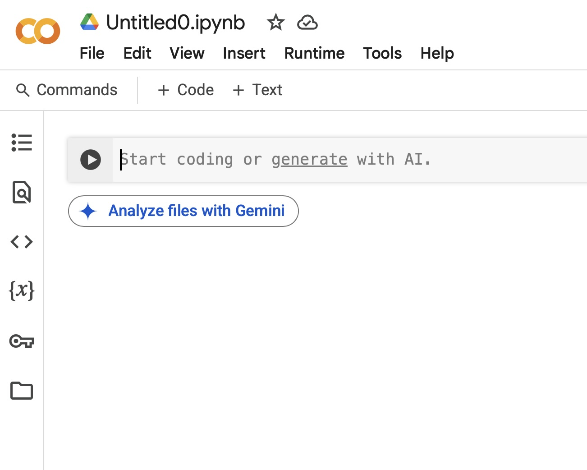
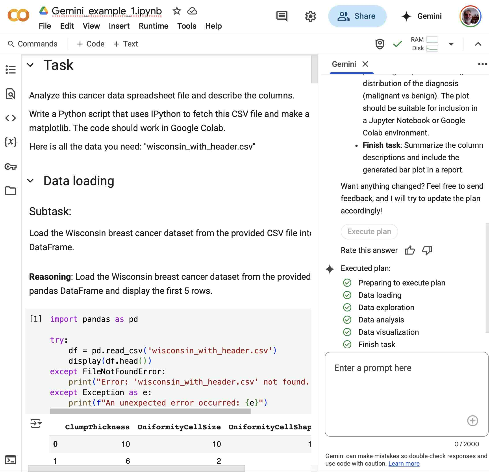
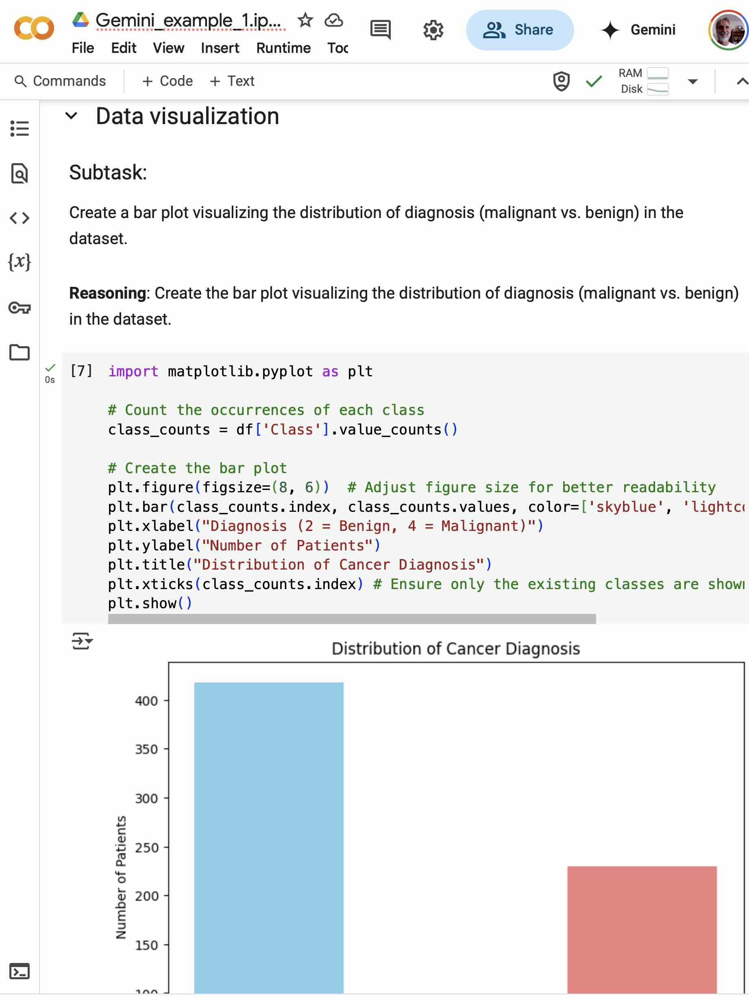

# Using Gemini to Write Python for Google Colab

Google Colab runs Python notebooks in your browser on Google's machines, so you need nothing installed on your laptop. Colab has Gemini built in, including a **Data Science Agent** that takes a data file and a goal, writes a plan, and then writes and runs the notebook cells that carry out the plan. For a solo knowledge worker who has data but does not want to write analysis code, this is the quickest path from a CSV file to charts.

## The Sample Data

I made a sample CSV file for cancer research available at [https://markwatson.com/data/wisconsin_with_header.csv](https://markwatson.com/data/wisconsin_with_header.csv). It is a version of the well known University of Wisconsin breast cancer data set: 647 rows, one per tissue sample, with nine measurements scored from 1 to 10 (`ClumpThickness`, `UniformityCellSize`, `UniformityCellShape`, `MarginalAdhesion`, `CellSize`, `BareNuclei`, `BlandChromatin`, `NormalNucleoli`, `Mitoses`) and a `Class` column where 2 means benign and 4 means malignant. Download this file to your laptop; we will use it with Colab's **Analyze files with Gemini** button.

## Asking Gemini for the Analysis

Prompt:

```text
Analyze this cancer data spreadsheet file and describe the columns.

Write a Python script that uses IPython to fetch this CSV file and make a bar plot of it using matplotlib. The code should work in Google Colab.
```

I created a new empty Colab notebook and worked through this example. Here is the link to the saved notebook:

    https://colab.research.google.com/drive/17EQ0TUCrHg3wWduBWj9KMJPc-9Lp669R?usp=sharing

The empty notebook has the button **Analyze files with Gemini**:



In the next screenshot I uploaded the sample CSV file and used the prompt listed above:



The agent shows its plan before it runs anything. Read the plan: it is your chance to correct a misunderstanding about the data before the agent writes code around it. Then accept the plan and let the agent write and run the cells.

In the following screenshot, I have closed the Gemini window on the right side of the Colab notebook and show example output:



If you look at the linked Colab notebook you will notice that some of the generated analysis code stopped with runtime errors and Gemini fixed these errors. This is normal for agent-written code. The agent runs a cell, reads the error, and tries again, much as you would.

## Checking the Agent's Work

The agent writes code that runs, which is not the same as code that is right. Before you use a result, check three things:

- **The column descriptions.** Does the agent's description of each column match what you know about the data? In this file, an agent that treats `Class` as a number to average, rather than as a label with two values, will produce charts that look fine and mean nothing.
- **Missing and odd values.** Ask the agent how many rows it dropped and why.
- **One number by hand.** Pick one figure from the output, such as the count of malignant samples, and check it yourself with a filter in Google Sheets.

## Colab, Gemini Notebook, or the Antigravity CLI?

This book shows three ways to have Gemini analyze a data file, and each has a place:

- **Colab** is the best choice when you want a notebook you can keep, rerun, and share, with the code and charts side by side.
- **Gemini Notebook** (covered in the ecosystem chapter) is adding code execution for Google AI Pro users, which suits a quick chart over a spreadsheet you already keep as a source in a research notebook.
- **The Antigravity CLI** (covered in Part 3) works on files on your own computer and writes ordinary Python scripts, which suits data you cannot or do not want to upload.

## Wrap Up

I use Google Colab notebooks often in my work. The example in this chapter shows Gemini writing, running, and fixing Python code for you. Let the agent do the typing, and spend your own time reading the plan and checking the results.
