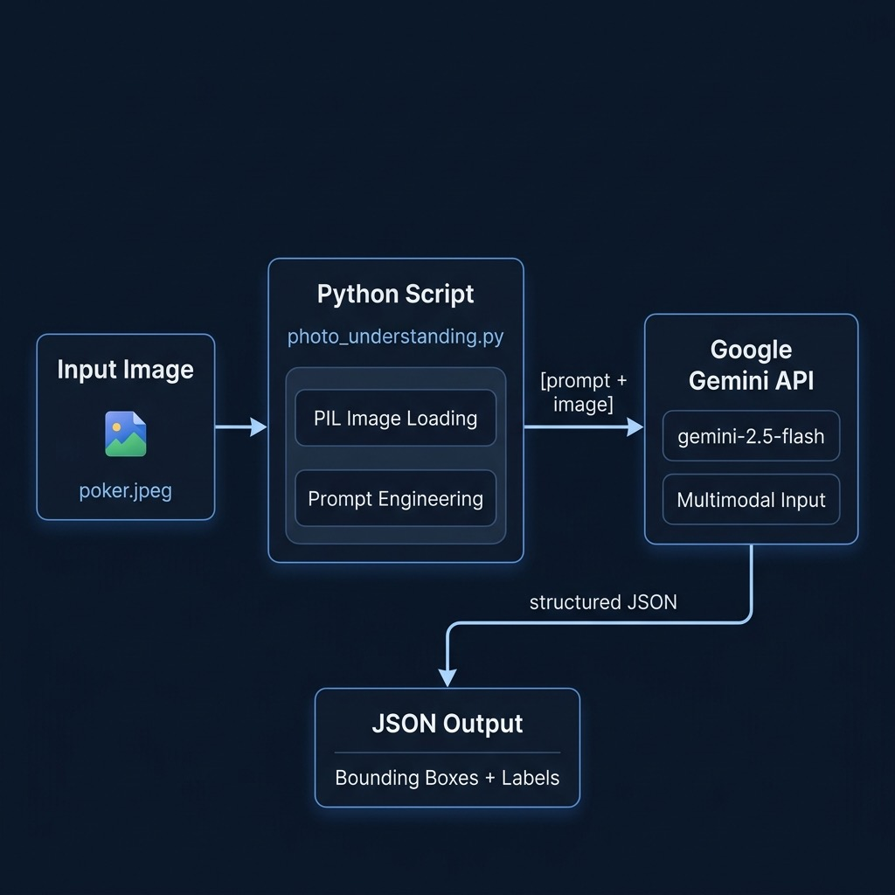

# Using Gemini For Both Images and Text (Multimodal Capabilities)



**Introduction**

In the previous chapters, we sent Gemini text prompts and set the thinking level for complex reasoning tasks. Modern models also handle **multimodal** input: several types of input in one request. You can combine a text prompt with images, audio, video, and PDF files.

This chapter sends an image and a text prompt to Gemini with the Python SDK, and asks the model to analyze the image. It also shows **structured output**, which makes the model return JSON that matches a schema you define. That combination covers visual question answering, image description, object detection, and pulling data out of photos.

## Prerequisites and Setup

1.  **Multimodal Model:** Use a Gemini model that accepts image input. The examples in this book use `gemini-4-hydrogen`, which accepts text, images, audio, video, and PDF files.
2.  **Python Environment:** Set up Python 3.12 or newer and `uv`, as covered in the authentication chapter.
3.  **Dependencies:** Image handling needs Pillow (a fork of PIL, the Python Imaging Library), and the structured output uses Pydantic. Add them with `uv`:

    ```bash
    uv add 'google-genai>=3.6.1,<4' 'pillow>=13.0.0' 'pydantic>=2.12.5'
    ```
    * `google-genai`: The Gemini Python SDK.
    * `Pillow`: Opens image files in Python so you can send them to the model.
    * `pydantic`: Defines the shape of the JSON you want back. The SDK already depends on it, but listing it makes the dependency explicit.

## Combining Text and Images in Prompts

To send multimodal input, pass a **list** as the `contents` argument of `generate_content` instead of a single string. Each element of the list is one part of the input. For a text and image prompt, the list holds:

1.  The text prompt, as a string.
2.  The image, loaded as a `PIL.Image` object.

The SDK encodes both parts and sends them in one request.

## Getting JSON You Can Trust

Earlier versions of this chapter asked for JSON in the prompt ("Return bounding boxes as a JSON array. Never return code fencing.") and hoped for the best. That works most of the time, which is not good enough for a program that parses the result.

The better way is **structured output**. You describe the shape of the answer with a Pydantic class, and pass two settings in the request config:

* `response_mime_type="application/json"` tells the model to reply with JSON only.
* `response_schema=...` gives the schema the JSON must match.

The SDK then parses the reply for you. `response.parsed` holds Python objects of your class rather than a string.

## Example: `photo_understanding.py` - Analyzing an Image

This script loads a photograph of five people playing poker. It makes two requests: one that returns a typed list of the people, and one that describes the scene in free text.

```python
import pathlib
import sys

from google import genai
from google.genai import types
from PIL import Image
from pydantic import BaseModel, Field

client = genai.Client()

# Google ships new models several times a year. See the model naming note in
# python_auth_setup.md when this model ID stops working.
MODEL_ID = "gemini-4-hydrogen"

IMAGE_PATH = pathlib.Path(__file__).parent.parent / "data" / "poker.jpeg"


class Person(BaseModel):
    box_2d: list[int] = Field(
        description="Bounding box as [ymin, xmin, ymax, xmax], scaled to 0-1000."
    )
    description: str = Field(description="What the person looks like.")
    holding: str = Field(description="What the person holds in their hands.")


def describe_people(image):
    response = client.models.generate_content(
        model=MODEL_ID,
        contents=[
            "Find up to 10 people in this picture. For each person, give a "
            "bounding box, a short description, and what they hold in their hands.",
            image,
        ],
        config=types.GenerateContentConfig(
            response_mime_type="application/json",
            response_schema=list[Person],
            thinking_config=types.ThinkingConfig(thinking_level="low"),
        ),
    )
    return response.parsed


def summarize_scene(image):
    response = client.models.generate_content(
        model=MODEL_ID,
        contents=["Describe what is happening in this picture in three sentences.", image],
        config=types.GenerateContentConfig(
            thinking_config=types.ThinkingConfig(thinking_level="low"),
        ),
    )
    return response.text


try:
    im = Image.open(IMAGE_PATH)
except FileNotFoundError:
    sys.exit(f"Image not found: {IMAGE_PATH}")

people = describe_people(im)
print(f"Found {len(people)} people:\n")
for i, person in enumerate(people, 1):
    print(f"{i}. box={person.box_2d}")
    print(f"   {person.description}")
    print(f"   holding: {person.holding}")

print("\nScene summary:")
print(summarize_scene(im))
```

**Explanation:**

1.  **Imports:** `pathlib` builds the image path, `PIL.Image` loads the image, and `pydantic` defines the schema.
2.  **Image path:** `pathlib.Path(__file__).parent.parent` is the `source-code` directory, found from the location of the script itself. The script therefore finds `data/poker.jpeg` no matter which directory you run it from.
3.  **The `Person` class:** Three fields, each with a `description`. The model reads those descriptions, so they work as part of the prompt. The box format, `[ymin, xmin, ymax, xmax]` on a 0 to 1000 scale, is the format Gemini uses for object detection, whatever the size of the image.
4.  **`describe_people`:** Sends the prompt and the image in one `contents` list. The config asks for JSON that matches `list[Person]`, and uses a low thinking level because finding people in a photo does not need long reasoning. `response.parsed` returns a list of `Person` objects.
5.  **`summarize_scene`:** A second request on the *same* image with a free text prompt. This shows how to ask several questions about one image without loading it twice.
6.  **Error handling:** If the image is missing, the script exits with a message that shows the path it tried.

### Interpreting the Output

Here is the output from one run:

```text
Found 5 people:

1. box=[254, 0, 991, 323]
   Older man wearing a dark baseball cap, glasses, and a grey sweatshirt.
   holding: playing cards
2. box=[204, 140, 466, 349]
   Older bald man wearing a grey zip-up hoodie.
   holding: nothing
3. box=[197, 437, 391, 628]
   Older woman with white hair wearing a beige cardigan and a dark red scarf.
   holding: playing cards
4. box=[257, 742, 460, 875]
   Older woman with short light brown hair wearing a white vest.
   holding: nothing
5. box=[179, 597, 998, 998]
   Older man with white hair and a beard wearing a dark green long-sleeve shirt and jeans.
   holding: playing cards

Scene summary:
Five older adults are gathered around a long wooden table in a bright, cozy room, smiling warmly at the camera. They are in the middle of a friendly game of poker, with stacks of colorful chips and playing cards spread out across the table. The room features large windows letting in natural light, along with potted plants and comfortable upholstered chairs.
```

Because the first result is a list of objects, the program can use it directly. `person.box_2d` is a list of four integers and `person.holding` is a string. No JSON parsing, no stripping of code fences, and no surprise when the model words its answer differently. To draw the boxes on the image, scale each coordinate by the image width or height divided by 1000.

## Potential Applications

Processing images and text together enables many applications, including:

* **Visual Question Answering (VQA):** Ask specific questions about an image ("What color is the car?", "Are there any animals in this picture?").
* **Image Captioning/Description:** Generate detailed text descriptions of an image.
* **Object Detection & Analysis:** Find objects, get their bounding boxes, and describe their attributes.
* **Data Extraction from Images:** Pull text or structured data from photos of receipts, whiteboards, or signs. Structured output is the right tool here: define a `Receipt` class with the fields you need.
* **Image Comparison:** Send two images and ask the model to describe the differences.

## Generating Images

This chapter sends images *to* Gemini. Google also has models that *create* images. The current one is **Nano Banana 2.1** (`gemini-nano-banana-2.1`). The easiest way to try it is in Google AI Studio, covered in the ecosystem chapter, where you can type a prompt and download the result. From Python you call it with the same `generate_content` method used in this chapter, and the image comes back as a part of the response. See the image generation page in Google's [Gemini API documentation](https://aistudio.google.com/docs) for code.

## Wrap Up

Gemini's multimodal input lets you combine text prompts and images in one API call. Put your instructions and the loaded image in a list and pass it as `contents`. When your program needs to use the answer, define a Pydantic class and ask for structured output, so you get typed objects instead of text you have to parse. Use a model that accepts images, keep Pillow in your project dependencies, and use a low thinking level when you want a fast answer.
