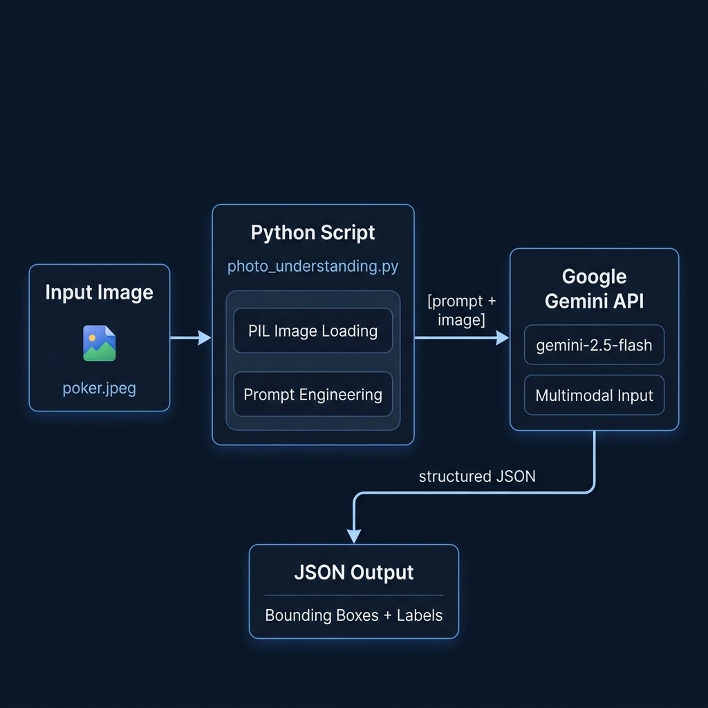

# Using Gemini For Both Images and Text (Multimodal Capabilities)



**Introduction**

In the previous chapters, we explored how to interact with Gemini models using text-based prompts, including setting the thinking level for complex reasoning tasks. However, one of the significant advancements in modern AI is **multimodality**: the ability of models to process and understand information from multiple types of input at once. The Gemini models excel at this, so you can combine text prompts with images, audio, video, and PDF files in a single request.

This chapter focuses on demonstrating how to use the Gemini Python SDK to send both an image and a text prompt to a capable Gemini model. We will ask the model to analyze the content of the image based on instructions provided in the text prompt. This opens up powerful possibilities for visual question answering, image description, object recognition, and more.

## Prerequisites and Setup

1.  **Multimodal Model:** Ensure the `MODEL_ID` you use corresponds to a Gemini model version that supports image input. The examples in this book use `gemini-3.8-flash`, which accepts text, images, video, audio, and PDF files.
2.  **Python Environment:** You need your Python environment set up as discussed in Chapter 2. Python 3.12 or newer.
3.  **Updated Dependencies:** Image processing requires an additional library, Pillow (a fork of PIL, the Python Imaging Library). Add it to your project using `uv`:

    ```bash
    uv add 'google-genai>=2.29.0' 'pillow>=12.3.0'
    ```
    * `google-genai`: The Gemini Python SDK, which provides the `genai.Client` interface for interacting with Gemini models.
    * `Pillow`: This library opens, manipulates, and prepares image files in Python so they can be sent to the model.

    `uv` will resolve all dependencies, update your `pyproject.toml`, and regenerate the lockfile automatically.

## Combining Text and Images in Prompts

The key to sending multimodal input using the Gemini Python SDK lies in how you structure the `contents` argument passed to the `generate_content` method. Instead of passing a single string (like we did for text-only prompts), you pass a **list** where each element represents a different part of the input.

For a text-and-image prompt, this list will typically contain:

1.  The text prompt (as a string).
2.  The image data (often loaded as a `PIL.Image` object).

The SDK handles the necessary encoding and formatting to send both the text instructions and the image pixels to the Gemini API endpoint.

## Example: `photo_understanding.py` - Analyzing an Image

This script demonstrates loading a local image file and sending it along with two different text prompts to a multimodal Gemini model to analyze the people depicted.

*(Please ensure you have an image file located at `../data/poker.jpeg` relative to where you run this script, or modify the `image` path accordingly.)*

```python
from google import genai
from google.genai import types
from PIL import Image

import os

client = genai.Client(api_key=os.getenv("GOOGLE_API_KEY"))

# Google ships new Flash models several times a year. See the model naming
# note in python_auth_setup.md when this model ID stops working.
MODEL_ID = "gemini-3.8-flash"

prompt = """
    Return bounding boxes around people as a JSON array with labels. Never return masks or code fencing. Limit to 10 people.
    Describe each person identified in a picture.
      """

image_path = os.path.join(os.getcwd(), "..", "data", "poker.jpeg")

im = Image.open(image_path)

# Gemini 3.8 Flash cannot turn thinking off completely. Use the lowest
# thinking level when you want the fastest answer.
response = client.models.generate_content(
    model=MODEL_ID,
    contents=[prompt, im],
    config=types.GenerateContentConfig(
        thinking_config=types.ThinkingConfig(
            thinking_level="low"
        )
    )
)

print(response.text)

prompt2 = """
    Return bounding boxes around people as a JSON array with labels. Never return masks or code fencing. Limit to 10 people.
    Describe each person identified in a picture, specifically what they are holding in their hands.
      """

response = client.models.generate_content(
    model=MODEL_ID,
    contents=[prompt2, im],
    config=types.GenerateContentConfig(
        thinking_config=types.ThinkingConfig(
            thinking_level="low"
        )
    )
)

print(response.text)
```


**Explanation:**

1.  **Imports:** `PIL.Image` for image handling, alongside the Gemini libraries and `os`.
2.  **Client & Model:** Initialization uses `genai.Client`, and `MODEL_ID` selects the model. One constant at the top means a model change is a one line edit.
3.  **Prompt 1:** Defines the first analysis task: identify people, provide bounding boxes in JSON format (with an explicit negative constraint, "Never return masks or code fencing"), limit the count, and provide descriptions.
4.  **Image Loading:** The script builds the path to the image file (`../data/poker.jpeg`) relative to the working directory and uses `Image.open()` from Pillow to load it into `im`.
5.  **API Call 1:** This is the core of the multimodal request.
    * `contents=[prompt, im]`: the text prompt and the loaded Pillow Image object go in one list.
    * `config=...`: `thinking_level="low"` keeps the answer fast, because describing an image does not need extended reasoning.
6.  **Response 1:** `response.text` holds the JSON array of bounding boxes and the descriptions.
7.  **Prompt 2:** A new prompt refines the request to focus on what each person is holding.
8.  **API Call 2:** A second call uses the *same* loaded image (`im`) with the *new* prompt (`prompt2`). The structure is identical, which shows how to ask several questions about one image.
9.  **Response 2:** The output now contains bounding boxes and descriptions focused on what the people hold.
10. **Error Handling:** `Image.open()` raises `FileNotFoundError` when the file is missing. Add a `try`/`except` block around the whole script when you write code that other people will run, and print the path you tried so the error is easy to act on.

### Interpreting the Output

Here is the output:

```json
[
  {"box_2d": [198, 438, 394, 628], "label": "people"},
  {"box_2d": [175, 592, 988, 1000], "label": "people"},
  {"box_2d": [257, 734, 530, 876], "label": "people"},
  {"box_2d": [203, 146, 473, 346], "label": "people"},
  {"box_2d": [253, 0, 996, 324], "label": "people"}
]
```
```text
A group of five people are playing poker at a long table. The woman at the top of the table has short white hair and is wearing a red scarf. The man to her left has short gray hair and is smiling. To his left is a man wearing a black baseball cap and a gray sweatshirt. To the right of the woman with white hair is another woman with short brown hair, and to her right is a man with a gray beard and a green shirt.
```
```json
[
  {"box_2d": [198, 437, 387, 627], "label": "a person holding cards"},
  {"box_2d": [254, 0, 1000, 326], "label": "a person holding cards"},
  {"box_2d": [177, 593, 996, 1000], "label": "a person holding cards"},
  {"box_2d": [205, 155, 467, 351], "label": "a person"},
  {"box_2d": [257, 734, 464, 877], "label": "a person"}
]
```


The `response.text` from these calls will contain the model's analysis based on *both* the text instructions and the visual information in `poker.jpeg`. You would expect to see:

* A JSON formatted string representing the bounding boxes for detected people.
* Text descriptions corresponding to each identified person, tailored to the specifics of `prompt` or `prompt2`.

Parsing the JSON and associating it with the descriptions would be the next step in a real application.

## Potential Applications

This ability to process images and text together enables many applications, including:

* **Visual Question Answering (VQA):** Ask specific questions about an image ("What color is the car?", "Are there any animals in this picture?").
* **Image Captioning/Description:** Generate detailed textual descriptions of an image's content.
* **Object Recognition & Analysis:** Identify objects and describe their attributes or relationships ("Describe the furniture in the room.").
* **Data Extraction from Images:** Pull text or structured data from photos of documents, whiteboards, or signs.
* **Image Comparison:** Provide two images and ask the model to describe the differences.

## Wrap Up

Gemini's multimodal capabilities significantly broaden the scope of tasks you can accomplish. By using the Python SDK and a library like Pillow, you can combine text prompts and image data in a single API call. The key is structuring the `contents` parameter as a list that holds your textual instructions and the loaded image object. That lets you build applications that read and reason about visual information under your textual guidance. Remember to use a model that supports multimodal input, keep `Pillow` in your project dependencies (`uv add Pillow`), and use a low thinking level when you want a fast answer.
