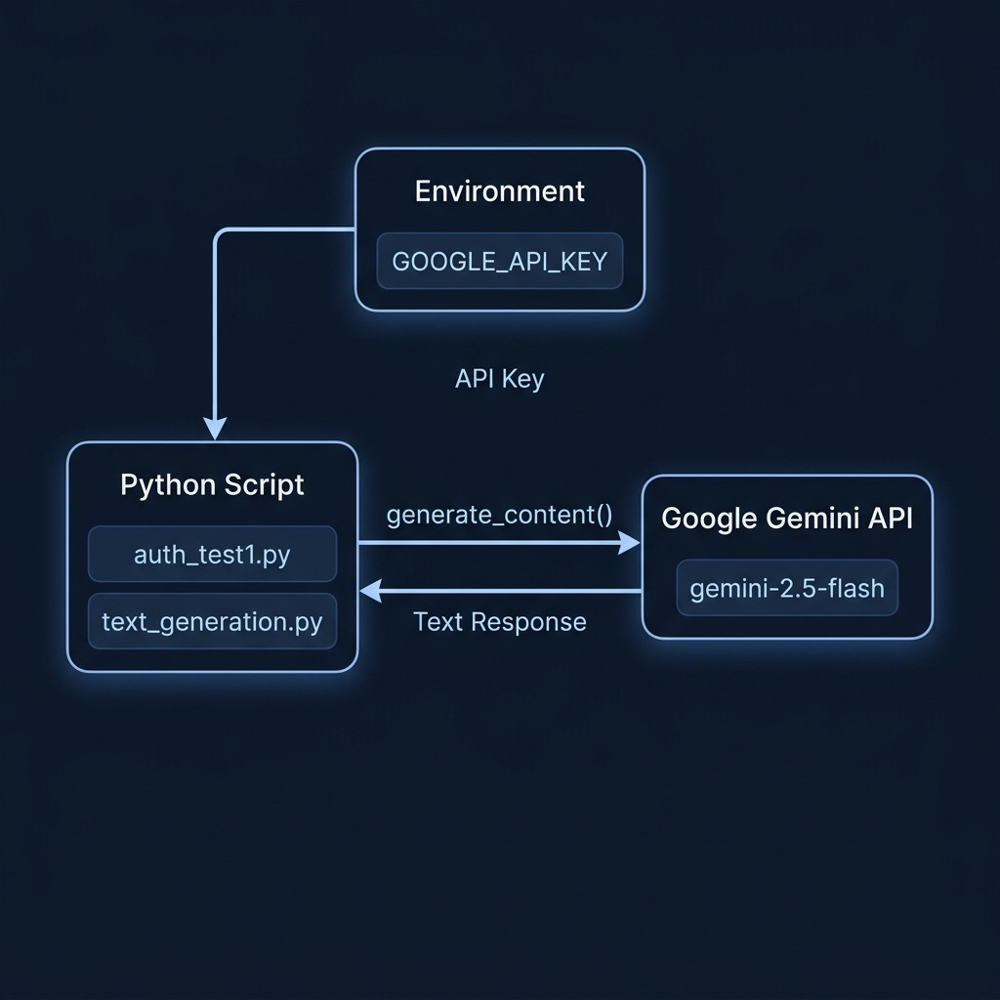

# Authentication and Setup for Google Gemini API



This directory contains three starter scripts that show how to authenticate with the Google Gemini API and generate text.

## Prerequisites

- Python 3.12 or newer
- A `GOOGLE_API_KEY` environment variable set with your Gemini API key from [Google AI Studio](https://aistudio.google.com/app/api-keys)

Install dependencies with `uv`:

```bash
uv sync
```

## Scripts

### `auth_test1.py`

Verifies that your API key works. It creates a `genai.Client`, prints the SDK version, and lists the models that support `generate_content`. Run this first to confirm your setup.

```bash
uv run python auth_test1.py
```

### `text_generation.py`

Generates text with the `gemini-4-hydrogen` model. It sends a brainstorming prompt and prints the response.

```bash
uv run python text_generation.py
```

### `interactions_demo.py`

Makes a two-turn request through the Interactions API (`client.interactions.create`). The second turn refers back to the first with `previous_interaction_id`, so the script does not resend the conversation history.

```bash
uv run python interactions_demo.py
```

## Key Concepts

- **API Key Authentication**: `genai.Client()` reads the key from `GOOGLE_API_KEY` or `GEMINI_API_KEY`. If both are set, `GOOGLE_API_KEY` wins.
- **SDK Version**: The examples use `google-genai` 3.x, which calls the stable `v1` API by default.
- **Content Generation**: `client.models.generate_content()` sends a prompt and returns the model response.
- **Interactions API**: `client.interactions.create()` returns an interaction with `output_text` and an `id` that you can pass to the next turn.
- **Model ID Constant**: `MODEL_ID` is defined once per file. Change that one line when Google ships a newer model.
