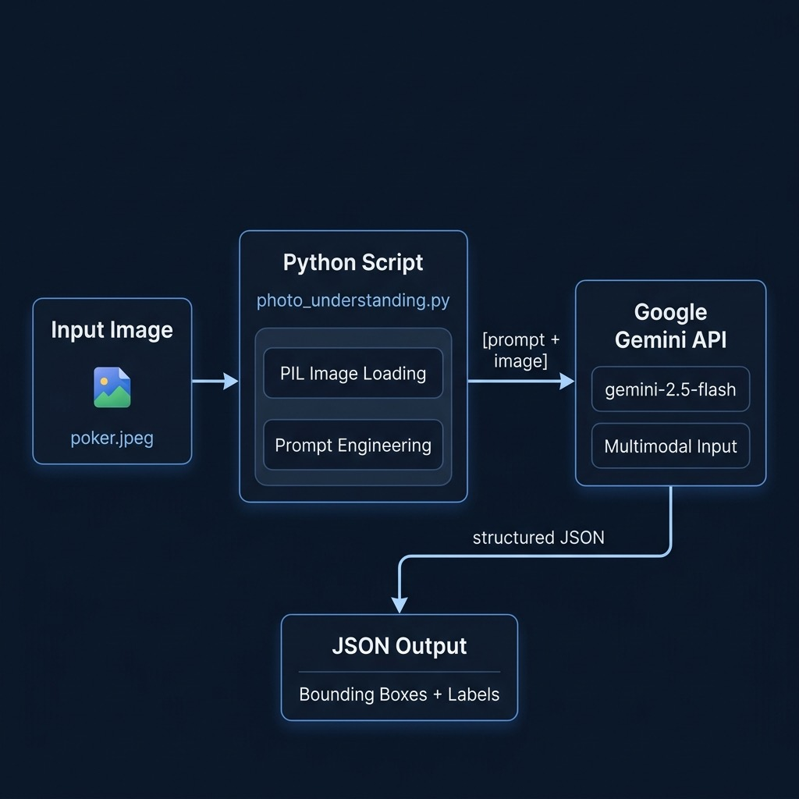

# Using Gemini with Images: Multimodal Photo Understanding



This directory shows Gemini's multimodal input by sending an image along with a text prompt. The script analyzes a photograph and gets back typed Python objects that hold a bounding box, a description, and what each person holds.

## Prerequisites

- Python 3.12 or newer
- A `GOOGLE_API_KEY` environment variable set with your Gemini API key

Install dependencies with `uv`:

```bash
uv sync
```

## Script

### `photo_understanding.py`

Loads `../data/poker.jpeg` with Pillow, then makes two requests:

1. **Structured detection**: finds the people and returns a list of `Person` objects, using a Pydantic schema and JSON output mode.
2. **Free text summary**: describes the scene in three sentences.

The script finds the image relative to its own location, so you can run it from any directory.

```bash
uv run python photo_understanding.py
```

### Example Output

```text
Found 5 people:

1. box=[254, 0, 991, 323]
   Older man wearing a dark baseball cap, glasses, and a grey sweatshirt.
   holding: playing cards
2. box=[204, 140, 466, 349]
   Older bald man wearing a grey zip-up hoodie.
   holding: nothing
...
```

## Key Concepts

- **Multimodal input**: `contents=[prompt, image]` sends text and a Pillow image in one request.
- **Structured output**: `response_mime_type="application/json"` plus `response_schema=list[Person]` makes the model return JSON that matches the schema. `response.parsed` holds the result as `Person` objects.
- **Bounding boxes**: Gemini returns boxes as `[ymin, xmin, ymax, xmax]` scaled to 0 through 1000, whatever the image size.
- **Low thinking level**: `thinking_level="low"` keeps the response fast. You cannot turn thinking off on Gemini 4 models.
