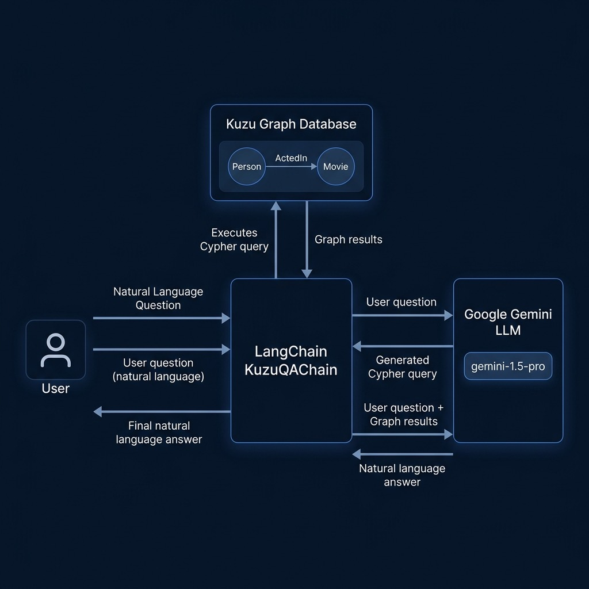

# Knowledge Graph QA with LadyBug, LangChain, and Gemini



This example builds a movie knowledge graph in the LadyBug embedded graph database, then uses LangChain with Google Gemini to answer natural language questions by writing and running Cypher queries.

Derived from an example in the "Ollama in Action" book.

## Prerequisites

- Python 3.12 or newer
- A `GOOGLE_API_KEY` environment variable set with your Gemini API key

Install dependencies with `uv`:

```bash
uv sync
```

`langchain-google-genai` 4.5 requires `google-genai` 3.3 or newer, so this project uses the 3.x SDK.

## Scripts

### `demo_ladybug_basics.py`

A smoke test for the LadyBug install. It creates a small database, inserts a few rows, and queries them back. Run this first if LadyBug gives you trouble.

```bash
uv run python demo_ladybug_basics.py
```

### `movies_demo_ladybug.py`

1. **Removes any old database** at `test_db_ladybug`, so each run starts fresh.
2. **Creates a graph schema** with `Person` and `Movie` nodes connected by `ActedIn` relationships.
3. **Loads the graph** with actors and films, using Cypher query parameters.
4. **Answers questions** through a Text2Cypher chain built with LangChain Expression Language:
   - Gemini writes a Cypher query from the question.
   - The script refuses anything that is not a read-only query.
   - LadyBug runs the query.
   - Gemini answers the question from the query results.
5. **Deletes the database** when it finishes.

```bash
uv run python movies_demo_ladybug.py
```

### Example Output

```text
> Question: Who acted in The Godfather: Part II?
  Generated Cypher: MATCH (p:Person)-[:ActedIn]->(m:Movie {name: 'The Godfather: Part II'})
RETURN p.name
< Answer: Al Pacino, Robert De Niro, and Diane Keaton acted in The Godfather: Part II.
```

## Key Concepts

- **Graph Database**: LadyBug is an embedded, ACID-compliant graph database, so there is no server to install or manage.
- **Query Parameters**: `conn.execute(query, {"name": ...})` fills in `$name` safely instead of pasting strings into the query.
- **Manual Text2Cypher**: The example wires the prompts together with LangChain Expression Language instead of a packaged QA chain, which keeps each step visible.
- **Read-only Guard**: Model-written queries run only if they start like a read query and contain no write clause.
- **Model ID Constant**: `MODEL_ID` is defined once. Change that one line when Google ships a newer model.
