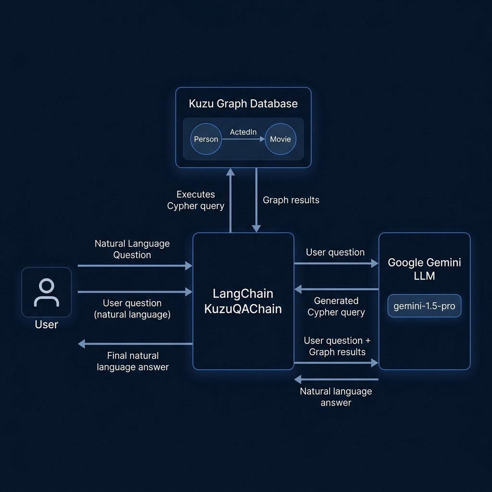

# Knowledge Graph QA with LadyBug, LangChain, and Gemini



This example builds a movie knowledge graph in the LadyBug embedded graph database, then uses LangChain with Google Gemini to answer natural language questions by generating and executing Cypher queries.

Derived from an example in the "Ollama in Action" book.

## Prerequisites

- Python 3.12 or newer
- A `GOOGLE_API_KEY` environment variable set with your Google AI API key

Install dependencies and run with `uv`:

```bash
uv sync
```

## Scripts

### `demo_ladybug_basics.py`

A smoke test for the LadyBug install. It creates a small database, inserts a few rows, and queries them back. Run this first if LadyBug gives you trouble.

```bash
uv run python demo_ladybug_basics.py
```

### `movies_demo_ladybug.py`

1. **Cleans up an existing database** by removing the `test_db_ladybug` path, so re-runs start fresh.
2. **Creates a graph schema** with `Person` and `Movie` nodes connected by `ActedIn` relationships.
3. **Populates the graph** with actors and classic films.
4. **Runs natural language queries** through a Text2Cypher chain built with LangChain Expression Language, which:
   - Sends the question to Gemini to generate a Cypher query.
   - Executes the Cypher against the LadyBug database.
   - Sends the results back to Gemini for a natural language answer.

```bash
uv run python movies_demo_ladybug.py
```

### Example Output

```text
> Question: Who acted in The Godfather: Part II?
  Generated Cypher: MATCH (p:Person)-[:ActedIn]->(m:Movie {name: "The Godfather: Part II"})
RETURN p.name
< Answer: The actors in The Godfather: Part II include Al Pacino, Robert De Niro, and Diane Keaton.
```

## Key Concepts

- **Graph Database**: LadyBug is an embedded, ACID-compliant graph database, so there is no server to install or manage.
- **Manual Text2Cypher**: The example wires the prompts together with LangChain Expression Language instead of a packaged QA chain, which keeps the two steps visible.
- **Gemini as Cypher Generator**: `MODEL_ID` is defined once in each file. Change that one line when Google ships a newer Flash model.
