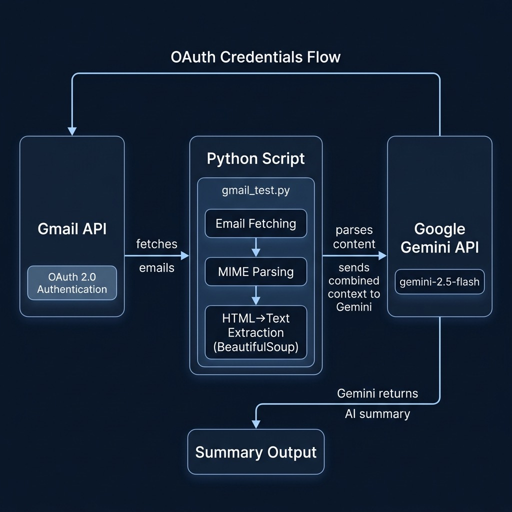

# Using Gemini with Google Apps: Gmail Email Summarization



This directory combines the Gmail API with Gemini to fetch your recent emails and summarize them, with a list of action items.

## Prerequisites

- Python 3.12 or newer
- A `GOOGLE_API_KEY` environment variable set with your Gemini API key
- An OAuth 2.0 client for the Gmail API (see the setup steps below)

Install dependencies with `uv`:

```bash
uv sync
```

## Set Up Gmail Access

Your Gemini API key does not give access to your Gmail. Reading your mail needs a separate OAuth 2.0 authorization, where you approve the script in a browser. You do this once.

1. **Create or pick a project** in the [Google Cloud Console](https://console.cloud.google.com/).
2. **Enable the Gmail API**: open "APIs & Services", then "Library", search for Gmail API, and click Enable.
3. **Configure the Google Auth Platform** (the old "OAuth consent screen"):
   - Branding: give the app a name and your email address.
   - Audience: choose **External**, leave the app in **Testing**, and add your own Gmail address as a **test user**. Personal Gmail accounts need this step.
4. **Create an OAuth client**: under "Clients", create a client with application type **Desktop app**. Download the JSON file and save it in this directory as `client_secret.json`.
5. **Authorize once**:

   ```bash
   uv run python create_gmail_token.py
   ```

   A browser window opens. Approve read-only access, and the script saves a token to `~/.gmail_token.json`.

Treat `client_secret.json` and `~/.gmail_token.json` like passwords. Never commit them to version control. The repository's `.gitignore` excludes `client_secret*.json` and `token.json`.

## Scripts

### `create_gmail_token.py`

Runs the OAuth flow with the read-only Gmail scope and saves the token as JSON, readable only by you.

### `summarize_gmail.py`

Fetches up to five emails from the last seven days, extracts their text (preferring `text/plain`, falling back to HTML through BeautifulSoup), and asks Gemini for a one line summary of each email plus a list of action items. It refreshes the token when it expires.

```bash
uv run python summarize_gmail.py
```

## Key Concepts

- **Two kinds of credentials**: the Gemini API key pays for the model, and the OAuth token grants access to your mail.
- **Least privilege**: the scope `gmail.readonly` lets the script read mail but never send, change, or delete it.
- **JSON tokens**: `Credentials.from_authorized_user_file` and `creds.to_json()` are the formats Google's own quickstarts use.
- **MIME parsing**: emails arrive in several formats. The script walks the message parts, prefers plain text, and falls back to HTML.
- **Model ID Constant**: `MODEL_ID` is defined once. Change that one line when Google ships a newer model.
