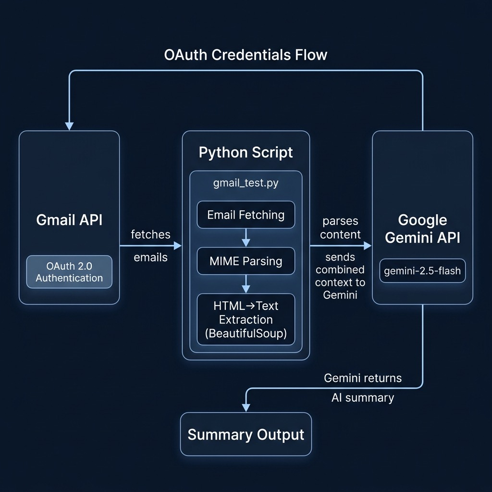

# Using Gemini with Google Apps — Gmail Email Summarization



This directory demonstrates how to combine Google Workspace APIs with Gemini AI to automatically fetch, parse, and summarize your Gmail emails using natural language.

## Prerequisites

- Python 3.12 or newer
- A `GOOGLE_API_KEY` environment variable set with your Google AI API key
- OAuth 2.0 credentials for Google Workspace (see setup instructions below)

Install dependencies with `uv`:

```bash
uv sync
```

## Get Credentials to Access Google Apps

The credential object is the crucial step for authorizing your Python script to access Google Workspace data (like Gmail, Calendar, etc.) on behalf of a user (which is likely yourself for your solo work). This uses the OAuth 2.0 protocol.

Here is the Google Cloud Console URI:

    https://cloud.google.com/cloud-console/welcome

Create a credential for viewing Gmail data and save the pickled credential to a file named **~/.gmail_cred**.

### Setup Steps

1. **Enable the API**: Go to the Google Cloud Console → "APIs & Services" → "Library" and enable the Gmail API (and any other APIs you need like Calendar, Drive, Docs).

2. **Create OAuth 2.0 Credentials**:
   - Go to "APIs & Services" → "Credentials"
   - Click "+ CREATE CREDENTIALS" → "OAuth client ID"
   - Configure the OAuth consent screen (select "External" user type for testing)
   - Choose "Desktop app" as the application type
   - Download the credentials JSON file and save it securely

3. **Authorize once and save the credential**. The example expects a pickled `Credentials` object at `~/.gmail_cred`. Create it with the `google_auth_oauthlib` flow, then keep the file private:

   ```python
   import pickle
   from google_auth_oauthlib.flow import InstalledAppFlow

   flow = InstalledAppFlow.from_client_secrets_file(
       "client_secret.json", scopes=["https://www.googleapis.com/auth/gmail.readonly"]
   )
   creds = flow.run_local_server(port=0)
   with open(os.path.expanduser("~/.gmail_cred"), "wb") as f:
       pickle.dump(creds, f)
   ```

4. **Treat the credentials file like a password.** Keep it secure and never commit it to version control.

## Scripts

### `summarize_gmail.py`

Fetches recent emails matching a search query, extracts their content (handling both plain text and HTML MIME types via BeautifulSoup), combines them into one context window, and sends them to Gemini for summarization. It refreshes the stored OAuth token when needed.

```bash
uv run python summarize_gmail.py
```

### `text_generation.py`

A simple Gemini text generation example (same as in `1_start_with_auth_and_setup`) included for reference.

## Key Concepts

- **OAuth 2.0 Authentication**: Required for personal Google Workspace data. The `googleapiclient` library builds the service object from the stored credential.
- **MIME Parsing**: Emails arrive in several formats. The script walks the message parts, prefers `text/plain`, and falls back to BeautifulSoup for HTML.
- **AI Summarization Pipeline**: The email content is combined into a single prompt context and sent to Gemini for a concise summary.
- **Model ID Constant**: `MODEL_ID` is defined once per file. Change that one line when Google ships a newer Flash model.

