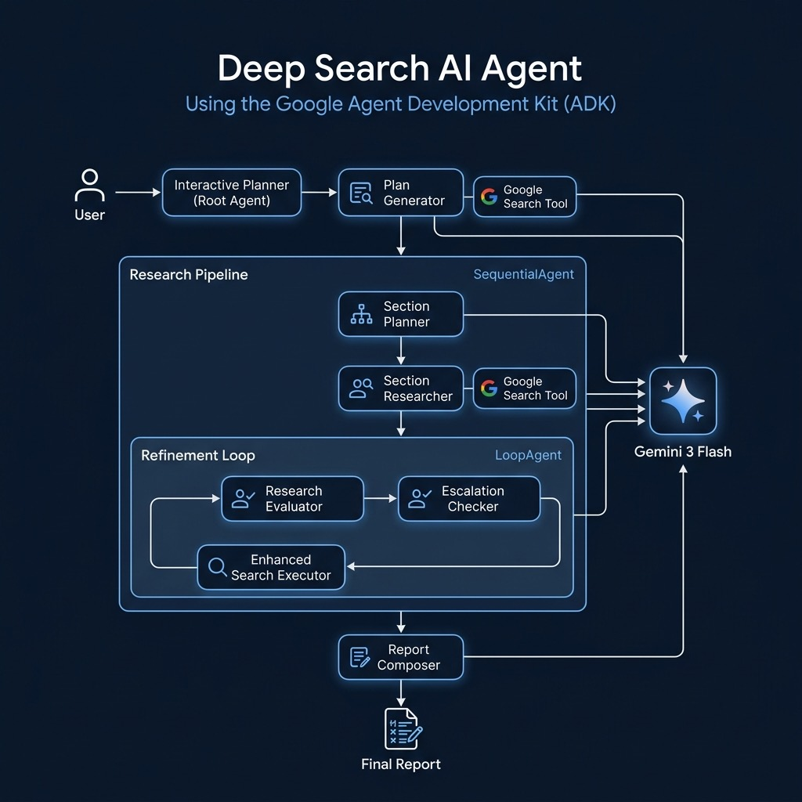

# Deep Search Agent with the Google Agent Development Kit (ADK)



This example builds a multi-agent research system with the [Google Agent Development Kit (ADK)](https://github.com/google/adk-python). The agents plan the research, run web searches, grade their own findings, and write a report with inline citations.

Derived from: [google/adk-samples deep-search](https://github.com/google/adk-samples/tree/main/python/agents/deep-search)

## Prerequisites

- Python 3.12 or newer
- A `GOOGLE_API_KEY` environment variable set with your Gemini API key

Install dependencies with `uv`:

```bash
uv sync
```

`google-adk` 2.14 requires `google-genai` older than 3.0, so this project uses the 2.x SDK while the other projects use 3.x. Each project has its own virtual environment, so the two versions never conflict.

## Script

### `deep_search.py`

An interactive command line research assistant. Enter a topic and the system will:

1. **Plan**: The interactive planner asks the plan generator for a five step research plan and shows it to you.
2. **Research**: After you approve the plan, the section researcher runs Google searches and summarizes what it finds.
3. **Evaluate**: The research evaluator grades the findings and lists follow-up queries for any gaps.
4. **Refine**: If the grade is fail, the search executor runs the follow-up queries. The loop repeats up to 3 times.
5. **Report**: The report composer writes the final report with citations, which a callback turns into Markdown links.

```bash
uv run python deep_search.py
```

Press Enter to approve the plan, type feedback to change it, or type `quit` to exit.

## Agent Architecture

| Agent | Type | Role |
|---|---|---|
| `interactive_planner` | `LlmAgent` (root) | Talks to the user and manages plan approval |
| `plan_generator` | `LlmAgent`, used as a tool | Creates the research plan with `[RESEARCH]` and `[DELIVERABLE]` steps |
| `section_planner` | `LlmAgent` | Designs the report outline (4 to 6 sections) |
| `section_researcher` | `LlmAgent` | Runs searches and summarizes the findings |
| `research_evaluator` | `LlmAgent` | Grades the research (pass or fail, with follow-up queries) |
| `escalation_checker` | `BaseAgent` | Ends the refinement loop when the grade is pass |
| `enhanced_search_executor` | `LlmAgent` | Fills gaps with follow-up searches |
| `report_composer` | `LlmAgent` | Writes the final cited report |

### Pipeline Composition

- **`SequentialAgent`**: runs section_planner, section_researcher, refinement_loop, and report_composer in order
- **`LoopAgent`**: runs evaluator, checker, and search executor, up to 3 times

ADK 2 marks `SequentialAgent` and `LoopAgent` as deprecated in favor of the new graph-based `Workflow`. They still work, and this example keeps them because a `Workflow` cannot yet be the sub-agent of an `LlmAgent`, which is how the interactive planner hands off to the pipeline.

## Key Concepts

- **Multi-Agent Orchestration**: ADK composes a complex workflow from small, focused agents.
- **Structured Output**: The Pydantic model `Feedback` forces the evaluator to return a typed grade.
- **Shared State**: Agents pass results through session state (`output_key`), and instructions read state with `{key}` placeholders.
- **Source Tracking**: A callback collects the web sources from Google Search grounding metadata, and another turns the composer's `<cite>` tags into Markdown links.
- **Context Caching**: `ContextCacheConfig` on the app gives each agent its own prompt cache, so agent transfers do not resend the whole prompt.
